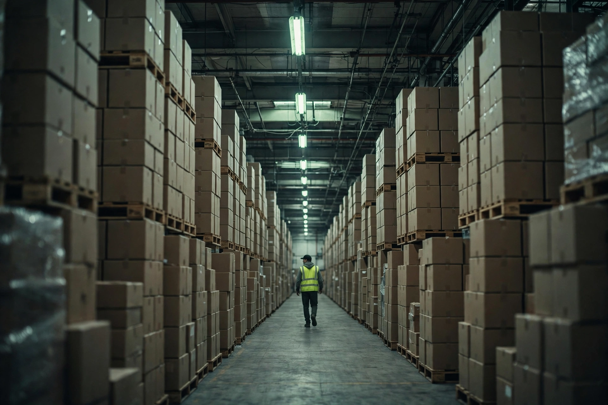

# Saturday, November 14, 2026 — Was the shortage manufactured? Nvidia under scrutiny, LangChain raises $300 million, Copilot goes down — and Meta gets an $805 million fine

Today's AI news fits in one sentence: the Wall Street Journal reports how Nvidia allegedly funded its own customers to absorb its chips — the same day LangChain raises $300 million to become the operating system for agents; the Microsoft outage switched Copilot off in 74 countries; Italy hands Meta its biggest fine ever for photos read without consent; and Anthropic publishes ten rules so that model safety tests actually mean something.

---

## 1. Nvidia: $530 billion in guarantees — was the shortage manufactured?

**What is it?** A Wall Street Journal investigation, published November 13, claims Nvidia used its own balance sheet to fund AI startups and small cloud providers — so they would keep buying its chips. The figure that swept Hacker News, where the story topped the front page with over 900 points: about $530 billion in total commitments and guarantees last quarter, up from $184 billion the quarter before, according to SemiAnalysis's reading of Nvidia's quarterly filing. In three months, Nvidia's financial promises nearly tripled — and much of that money, according to the Journal, exists to pay its own customers to keep buying.

**What actually changes:**
- **The August 2026 meeting, at the heart of the investigation.** The Journal describes a tense meeting between Jensen Huang, then CEO, and Colette Kress, his longtime CFO — now interim CEO since Huang resigned on November 11. Kress wanted to rein in the circular-financing commitments to small cloud providers and major AI companies such as OpenAI and Anthropic. Huang reportedly refused. Early discussions floated underwriting roughly 8 gigawatts of OpenAI computing capacity, valued at up to $250 billion; Kress got the signed guarantee cap cut to about 4.25 gigawatts, or up to $125 billion.
- **The private justification: an "avalanche" of silicon.** According to the Journal, Huang privately described the problem as an avalanche of prepaid silicon and memory committed to TSMC, the Taiwanese foundry. The big cloud companies are moving to their own chips; rather than letting the surplus flood the market and push prices down, Nvidia allegedly funded the buyers who would absorb it. Critics call this circular financing: the company's money helps buyers purchase its own products. Nvidia has since contacted TSMC to wind down upcoming chip orders, the Journal reports.
- **The numbers worrying investors.** Nvidia's receivables reportedly ballooned to $63 billion, with average payment terms stretching from 45 to 60 days — customers taking longer to pay for chips they may not need. Industry analyst Ed Zitron estimates at least $200 billion worth of Nvidia GPUs are sitting idle in warehouses, bought by cloud giants that lack either the grid capacity or the end-user demand to switch them on. Nvidia's shares fell 13% in the week the report emerged — its worst week since April 2025, wiping about $573 billion from the company's market value.
- **The test comes Tuesday.** Nvidia reports third-quarter results on Tuesday, November 17 — its first earnings since Huang's departure, presented by Kress as interim chief executive. That is when investors will see whether the Journal's figures show up in the accounts.
- **What Nvidia disputes, and what is not established.** Nvidia has long rejected the circular-financing label, and Huang previously dismissed the idea. Above all: Nvidia has not confirmed the Journal's account, and no formal investigation has been publicly confirmed. What the Journal reports is documents and internal accounts — not a court ruling, not a regulator's accusation.

**Why it matters:** for three years, the defining fact of the AI boom was that you could not get Nvidia GPUs — waitlists, allocations, inflated prices. The whole industry organized itself around scarcity. If part of that scarcity was manufactured on the demand side — by funding the buyers rather than cutting prices — then the boom's founding story cracks: demand was not only strong, it was partly underwritten by the seller itself. And the link to this week's news is direct: this is the same week Huang resigned, employees petitioned for his return, and the board named Kress to lead the company. The question is no longer just "who runs Nvidia?" — it is "what did demand actually look like?" The answer, in verifiable figures, arrives Tuesday.

**Who it's for:** investors first — November 17 will be the first public test. But also every company that built its strategy on the idea of a lasting GPU shortage: if prices end up reflecting a surplus rather than scarcity, the profitability math of many infrastructure projects changes. And gamers, who have waited years for affordable graphics cards: according to Notebookcheck, even a Nvidia retreat from these financing deals would not bring back cheap GeForce cards in 2027 — data-center accelerators and gaming GPUs use neither the same components nor the same production lines.

**What we don't know yet:** whether Nvidia will confirm or precisely deny the Journal's figures on Tuesday; whether a regulator will open an investigation; or how much of the $530 billion in guarantees will one day turn into real losses if the funded customers cannot meet their commitments. Nor — an unconfirmed rumor relayed on Hacker News, with no official source — whether a Nvidia director sold nearly $1 billion in stock before the scandal broke.

*Sources: [dev.to — $530B in guarantees: Nvidia funded its own demand (from the WSJ investigation), Nov 14, 2026](https://dev.to/frankchu/530b-in-guarantees-nvidia-funded-its-own-demand-4g89) ; [PakTechStan — Huang Financed AI Startups to Buy Nvidia's Own Chips as a TSMC Glut Loomed, WSJ Reports, Nov 14, 2026](https://paktechstan.com/article/huang-financed-ai-startups-to-buy-nvidia-s-own-chips-as-a-tsmc-glut-loomed-wsj-reports) ; [Notebookcheck — Nvidia's retreat from Huang's circular AI financing won't bring back affordable GeForce cards in 2027, Nov 14, 2026](https://www.notebookcheck.net/Nvidia-s-retreat-from-Huang-s-circular-AI-financing-won-t-bring-back-affordable-GeForce-cards-in-2027.1450509.0.html) ; [Hacker News — front page, Nov 14, 2026](https://zeli.app/digest).*

---

## 2. LangChain raises $300 million: LangSmith wants to become the operating system for agents

**What is it?** LangChain, the startup behind the open-source LangChain and LangGraph frameworks and the LangSmith platform, announced on November 13 a $300 million Series C at a $3 billion valuation. The round is led by CapitalG, Alphabet's growth fund — already an investor. It is the biggest funding of the week in agent infrastructure, and it lands at the moment when the question is no longer whether companies will deploy agents, but how to run them without them going off the rails.

**What actually changes:**
- **A valuation multiplied by 2.4 in one year.** The previous round, about a year ago, was $125 million at a valuation of about $1.25 billion. LangChain's total funding now reaches $460 million. The Wall Street Journal reported the round on November 12; the company confirmed it the next day.
- **A very international round.** Alongside CapitalG: Singapore's sovereign wealth fund GIC and DFJ Growth as significant new investors, IVP and Sapphire Ventures among existing backers, plus Salesforce Ventures, Insight Venture Partners, QuantumLight and MongoDB Ventures. Sequoia, Amplify and Benchmark, already on the cap table, increased their stakes.
- **The money goes in three directions.** First, runtime: the machinery that actually runs agents — Deep Agents, LangGraph, the LangSmith Agent Server, Sandboxes, Managed Agents and Fleet. Second, improvement: observability and evaluations, the tooling that says whether an agent is getting better or worse. Third, governance: control over tools, models and budgets. The positioning is explicit: LangSmith wants to be the platform that runs, improves and governs agents in production, without locking a company into a single model provider.
- **The adoption figures, with the usual caveat.** LangChain says more than 7,000 organizations use LangSmith — Nvidia, Toyota, Salesforce, Workday, Harvey, Rippling, Clay — and that the platform handles over 1 billion events a day. The most concrete customer example: Workday reportedly cut the time to deploy a new agent from about five months to under a day. Those are LangChain's figures, unaudited, and the company disclosed neither revenue nor profitability. A $3 billion valuation on unaudited usage figures is a bet, not a measurement.
- **The first concrete test comes soon.** LangChain will show new LangSmith capabilities at a release event on Friday, November 20.

**Why it matters:** LangChain has moved from beloved open-source framework for developers to enterprise infrastructure vendor — and this round seals it. The timing is no accident: in the same week, OpenAI gives its agents a wallet, Anthropic makes its coordinators proactive, and everyone is deploying agents in production. But an agent in production is a program that acts alone, spends money, touches tools — and whose actions you must be able to account for afterwards. That is exactly the market LangSmith is targeting: not building agents, but running, evaluating and governing them. The week was rich in infrastructure funding in general: according to Crunchbase News, it also saw Mercor's $750 million Series D and Mirendil's $1 billion Series A. Money is following agent infrastructure — and valuations are following the money.

**Who it's for:** teams deploying agents in production who are discovering that the hard part is not making them work once, but making them work a thousand times without surprises. And open-source developers: LangChain and LangGraph remain open source, but the question at every raise like this is the same — how long does the free part stay the core of the product, and when does it become the funnel toward the paid platform?

**What we don't know yet:** what the November 20 features will actually be worth — the first concrete test of what this $300 million buys. Or how many of the 7,000 organizations are paying customers. Or, above all, whether evaluations and governance will be enough to convince the most cautious companies to let agents act alone on their systems.

*Sources: [AI Agent Update — summary of the LangChain announcement, Nov 14, 2026](https://aiagentupdate.com/post/langchain-300m-series-c-2026-11-14) ; [Pulse 2.0 — summary of the Business Wire release, Nov 14, 2026](https://pulse2.com/langchain-300-million-series-c-funding-led-by-capitalg-at-3-billion-valuation-to-expand-ai-agent-platform/) ; [GrowthList — summary of the TechCrunch and Crunchbase News reports, Nov 14, 2026](https://growthlist.co/langchain-300m-series-c-3b-capitalg-ai-agent-infrastructure/) ; [AI Frontier Post, Nov 14, 2026](https://aifrontierpost.com/articles/langchain-300m-series-c-3b-valuation/).*

---

## 3. Microsoft 365: the outage that switched Copilot off in 74 countries

**What is it?** A global Microsoft 365 outage began on Thursday, November 12 at 16:17 UTC and stretched into November 13. Outlook, Teams, Copilot, SharePoint and Defender XDR went down for users in 74 countries according to Downdetector — with reports multiplied by more than a hundred. The cause was not an attack, nor a traffic spike: it was a cascade of internal failures, starting in Exchange Online, the cloud email service everything else depends on. And that is precisely what makes the story interesting for this newsletter: Copilot went down with the rest, and so did OpenAI's and Anthropic's Microsoft 365 connectors.

**What actually changes:**
- **The mechanics of the cascade.** According to Microsoft, a large number of servers became unavailable after failing automated health checks. Traffic shifted onto the remaining servers, and a process responsible for establishing secure connections became overwhelmed — healthy servers in turn became unable to respond. Microsoft said it explicitly: the problem was not a sudden increase in traffic, but a reduction in the number of servers available to handle it.
- **It was not a cyberattack.** Charles Lamanna, Microsoft's Executive Vice President, confirmed it: no indication of malicious activity. That matters, because the first hypothesis for an outage of this scale is always an attack — and because the previous week, the Cursor incident had shown what a real supply-chain compromise can produce.
- **The first fixes did not work as expected.** Microsoft wrote it in black and white on its status account: the changes applied to improve the situation were "not taking as expected." Engineers then froze all routine software deployments, rerouted traffic, deployed an alternative health-check method and restarted the affected machines. Recovery was gradual: by the evening of November 12, Downdetector reports had fallen back to around 32,000, but Microsoft gave no timeline for full restoration.
- **Copilot and the AI connectors went down with the rest.** Users could no longer load Copilot Chat or get responses. OpenAI reported an issue with its Microsoft 365 connectors — new connections impossible, tools malfunctioning — and Anthropic reported similar problems. AI plugged into Microsoft 365 falls when Microsoft 365 falls: obvious once said, but the first time it has happened at this scale.
- **The third major outage of the year.** After a multi-hour outage in January and a code-update failure in August that took several days to fully resolve. The incidents are tracked as EX1550543 and MO1550821 in the Microsoft 365 admin center.

**Why it matters:** the Microsoft outage is the exact mirror of the Nvidia story from the same day. On one side, we learn that GPU demand may have been partly funded by the seller; on the other, we learn that desktop AI — Copilot, the connectors, the assistants plugged into email — rests on a single infrastructure, Exchange Online, whose failure stops everything. In both cases the lesson is the same: the AI ecosystem is more concentrated and more fragile than it looks. One email service goes down, and millions of users lose their email, their meetings and their AI assistant at once. And the cause — servers failing their own health checks, then a saturated process — is a reminder that the worst outages do not always come from outside: they come from a system taking itself offline, one server at a time.

**Who it's for:** every company that has plugged its AI assistants into Microsoft 365 — the outage showed that their continuity plan, if one exists, must cover AI like everything else. And teams evaluating Copilot: the question is no longer just "how good is the assistant?" but "how good is the assistant when the underlying service is down?"

**What we don't know yet:** the definitive root cause — Microsoft identified the overwhelmed process and the failing health checks, but has not published a full analysis. Or when the service will be back to normal for all users. Or whether Microsoft will publish a detailed post-incident report, as cloud providers usually do after an outage of this scale.

*Sources: [Microsoft 365 Status — X, Nov 12-13, 2026](https://www.businesstoday.in/amp/technology/story/microsoft-365-disruption-hits-74-countries-outlook-teams-and-copilot-knocked-offline-567213-2026-11-13) ; [Business Standard — Microsoft 365 outage continues, Nov 13, 2026](https://www.business-standard.com/amp/technology/tech-news/microsoft-365-outage-continues-as-company-sees-limited-recovery-in-services-126111300464_1.html) ; [BusinessToday — Microsoft 365 disruption hits 74 countries, Nov 13, 2026](https://www.businesstoday.in/amp/technology/story/microsoft-365-disruption-hits-74-countries-outlook-teams-and-copilot-knocked-offline-567213-2026-11-13) ; [News18 — Microsoft Outage Explained, Nov 13, 2026](https://www.news18.com/tech/microsoft-outage-explained-its-more-than-10-hours-why-outlook-teams-and-copilot-are-still-down-globally-10424138.html) ; [Moneycontrol — Fixes fail to work as expected, Nov 13, 2026](https://www.moneycontrol.com/world/microsoft-outage-fixes-fail-to-work-as-expected-outlook-teams-copilot-services-remain-affected-article-14079102.html).*

---

## 4. Italy: an €805 million fine against Meta — 20 million photo galleries read without consent

**What is it?** Italy's data protection authority, the Garante, announced this Saturday, November 14, a fine of €805 million — about $887 million — against Meta for accessing users' photos without their consent. It is by far the largest fine the Italian regulator has ever imposed, and one of the biggest ever handed down in Europe over a consent question. The feature at issue has existed since 2023: "Get suggestions from your gallery when browsing Facebook" offers photos and videos from the phone's gallery as post ideas. To offer it, the Facebook app on Android read the gallery — photos, videos and metadata — without obtaining specific consent, and without duly informing users.

**What actually changes:**
- **The scale: 20 million people.** The Garante took the number of people affected — around 20 million Android users in Italy — into account when setting the amount. The fine is about 0.47% of Meta's global turnover. The regulator also cited the duration of the infringement — still ongoing for users who have not updated the app — and what it describes as Meta's lack of cooperation.
- **60 days to comply.** Meta must switch the feature off by default and ask for separate, explicit consent, explaining what the feature does, that it needs gallery access, and how to turn it off. After the deadline, the feature cannot be switched on for anyone who has not given valid consent.
- **Italy, not Ireland.** Meta disputed the Garante's jurisdiction, arguing that its lead EU regulator is Ireland's Data Protection Commission. The Garante rejected the objection: it ruled under Article 122 of the Italian Privacy Code, which implements the EU ePrivacy directive — the rule that protects the confidentiality of terminals and communications. It is an important precedent: a national regulator can act directly on this basis, without going through the lead regulator.
- **The investigation lasted over a year.** Opened in July 2025 after a complaint from the Centro Tutela Consumatori Utenti in Bolzano, it included the regulator's own technical analysis.
- **The AI question stays open — and that is the point that matters here.** The investigation did not examine whether gallery content was used to train AI models. Meta denies it, and the Garante leaves that point undecided. The regulator did, however, reserve the right to assess separately a newer feature, launched in 2026, that processes gallery content in the cloud. In other words: the fine covers the access, not the use — but the use remains to be examined.

**Why it matters:** a phone's photo gallery is among the most intimate data there is — family photos, documents, screenshots, images never meant to be published. That an app reads them by default, behind a vague permission prompt, to suggest posts is exactly the kind of practice the GDPR and the ePrivacy directive are supposed to forbid. And the context is this newsletter's beat: AI models need data, and photo galleries are an immense source of it. The fine does not say Meta trained its models on these photos — it says that the access itself, without specific consent, was worth €805 million. It is a signal to every company building AI features around personal data: fuzzy consent is no longer enough, and the price of ambiguity is now counted in hundreds of millions. The Italian decision also lands the same week the European Commission is hardening its tone on training data — the subject is no longer theoretical.

**Who it's for:** the 20 million Italian Android users affected first — they should receive a clear consent request within 60 days. And every company processing personal photos for AI features: the line between "suggesting a post" and "feeding a model" is thin, and regulators are now watching both sides of it.

**What we don't know yet:** whether Meta will appeal — the company had not reacted publicly at the time of the announcement. Or whether other European regulators will follow on the same ePrivacy basis. Or, above all, what the separate assessment of the 2026 cloud feature will say — the one that processes gallery content on servers, and that is closest to a training pipeline.

*Sources: [Reuters — Italy fines Meta $887 million over Android users' data access, Nov 14, 2026](https://www.reuters.com/world/italy-fines-meta-887-million-over-android-users-data-access-2026-11-14/) ; [Al Jazeera — Italy fines Meta $880m over photo privacy, Nov 14, 2026](https://www.aljazeera.com/news/2026/11/14/italy-fines-meta-880m-over-photo-privacy?traffic_source=rss) ; [Le Temps — Meta fined €805 million in Italy, Nov 14, 2026](https://www.letemps.ch/en/cyber/meta-fined-805-million-in-italy-for-accessing-photos-without-users-consent) ; [ShiftDelete — Meta Fine: €805M Over Facebook Android Photo Access, Nov 14, 2026](https://shiftdelete.net/en/meta-fine) ; [DigitBin — Italy Fines Meta €805M Over Facebook Android Gallery Access, Nov 14, 2026](https://www.digitbin.com/facebook-android-gallery-fine-italy/).*

---

## 5. Anthropic: ten rules so model safety tests actually mean something

**What is it?** Anthropic published on November 13 an engineering blog post, "Building Strong Safety Evaluations," laying out ten recommendations for designing, running and reporting AI safety evaluations. The starting point is simple and embarrassing for the whole industry: the tests that decide whether a model can ship, what safeguards it needs, and what the next training run should watch for are often easy to game, do not always measure what they claim to measure, and are rarely documented well enough to be reproduced. Anthropic draws on its own experience — its system cards cover 16 policy areas in seven languages — and on the lessons of psychology's replication crisis.

**What actually changes:**
- **Single-turn tests are saturated.** Every recent Anthropic model scores between 94% and 98% appropriate responses on its single-turn API tests. These tests are now mostly useful as regression checks — verifying nothing broke — not as safety measures. The real work now happens in multi-turn tests: full-conversation simulations, with risk-specific rubrics, where one bad turn fails the whole exchange.
- **A refusal is not proof of safety.** A model that refuses everything about self-harm scores perfectly on a refusal-rate test — without being safer. Anthropic recommends measuring the appropriate-response rate, not the refusal rate, and testing in realistic conversations rather than on isolated questions.
- **Preregister before looking at the results.** As in psychology after the replication crisis: write down in advance which metrics you will measure, which comparisons you will make and which thresholds you are aiming for — so you cannot pick the flattering reading afterwards.
- **Validate the grader, not just the model.** Evaluations often use another model as a judge. Anthropic recommends calibrating these automated graders against human judges, with atomic yes-or-no criteria, explicit handling of borderline cases and loud failure alerts — and watching for length, position and self-preference biases.
- **Minimum sample sizes, and error bars on display.** At least 100 items for complex multi-turn evaluations, 1,000 for simpler single-turn tests, with repeated runs to account for the models' nondeterministic outputs. Confidence intervals on multi-turn evaluations can exceed ±10 percentage points: in a romance-scam evaluation on claude.ai, Claude Opus 5 scored 98% and Opus 5.5 scored 94% — a difference that was not statistically significant. In other words: two numbers that look different can mean nothing.
- **Containment first.** For cyber evaluations, sandboxes without internet access and real-time monitoring, so a run can be stopped if the model's actions risk causing real-world harm. Anthropic has paused many tests that gave models internet access, and live-monitors the web-search tests that still need a connection.
- **Don't reinvent the wheel.** Use existing tooling: Inspect, the UK AI Security Institute's framework, and Petri, Anthropic's tool built on Inspect, which automates the multi-turn behavioral testing described in the post.
- **Two details that say a lot.** A disclaimer does not make a harmful answer acceptable. And a severe flaw stays private until a fix is possible.

**Why it matters:** all week, this newsletter has reported scores — Ripple at 80.52 on Terminal-Bench, Unsloth gaining 5-10%, models climbing rankings. Anthropic's post is the necessary counterpoint: a score is only worth the test that produced it, and most safety tests today are saturated, poorly documented or easy to circumvent. It is also a partial admission of powerlessness: even with multidisciplinary teams, sandboxes and preregistration, a test never proves a model is safe — it only proves it did not fail on that test. The approach is all the more credible for coming from a lab that publishes its own limits: 94 to 98% everywhere, error bars of ±10 points, differences that are not significant. In an industry that loves round numbers, publishing uncertainty is almost an act of militancy.

**Who it's for:** teams that buy or deploy models based on safety scores — the post gives them a checklist to ask: which test, which sample size, which error bar? And the labs themselves: ten public recommendations are also a standard the others will have to explain if they do not follow it.

**What we don't know yet:** whether the other labs will adopt these practices — or whether each will keep publishing its own scores, on its own tests, without error bars. Or whether regulators, notably under the EU AI Act, will draw on them to require documented, reproducible evaluations.

*Sources: [Anthropic — Building Strong Safety Evaluations, Nov 13, 2026](https://www.anthropic.com/research/building-strong-safety-evaluations) ; [Crypto Briefing — Anthropic shares 10 recommendations for building better AI safety evaluations, Nov 13, 2026](https://cryptobriefing.com/anthropic-recommendations-ai-safety-evaluations/) ; [The Circuitry — Anthropic publishes 10 recommendations for safety evaluations, Nov 13, 2026](https://thecircuitry.to/article/anthropic-publishes-10-recommendations-for-safety-evaluations-mwfcjn57) ; [Unite.AI (via EuropeSays) — Anthropic Publishes Guidance for More Reliable AI Safety Evaluations, Nov 13, 2026](https://www.europesays.com/ai/240175/) ; [The Daily Fledgling — Morning Edition, Nov 14, 2026](https://thedailyfledgling.click/).*

---

## Bonus — The luck of the day: "If AI solved coding, why is my software still the same?"

**What is it?** A video by game developer Jonathan Blow, titled "If AI solved coding, why is my software still the same?", reached the Hacker News front page on November 13-14, with over 150 comments. The question is simple, and it stings: if AI speeds up writing code so much, why aren't the apps we use getting better?

**What he says:** the thesis, as relayed in the discussions, is that the bottleneck is not how fast code gets written, but everything else — decisions, maintenance, review, taste. Writing faster does not make software better, any more than typing faster makes a book better. It is the video echo of the "No AI Slop" manifesto covered in the 08:00 edition: producing costs zero, reviewing still costs the same, and the only variable we control is what we choose to produce.

**The lesson that goes with it:** this edition tells the story of agents that pay, code in parallel, get evaluated and governed — and an industry raising hundreds of millions to make them run faster. Blow's video asks the question nobody asks in funding rounds: faster, for what? If software is not improving, maybe the problem was never writing speed. It is an uncomfortable question for a newsletter that follows AI closely — and precisely for that reason, it deserves its place here.

**Who it's for:** every team measuring its productivity in lines of code produced by its agents — and starting to wonder whether they are measuring the right thing.

*Sources: [Hacker News — front page, Nov 13-14, 2026](https://zeli.app/digest) ; [Dev Community — If AI Makes Us Faster, Why Aren't The Apps We Use Getting Better?, Nov 14, 2026](https://news-area.com/2026/11/14/if-ai-makes-us-faster-why-arent-the-apps-we-use-getting-better/).*

---

## What this day tells us

- **AI demand is financing itself — and the market is starting to count.** Nvidia allegedly funded its own buyers to absorb its silicon; LangChain raises $300 million to govern agents whose revenue nobody discloses. In both cases, money follows agent infrastructure — but the figures justifying it are self-reported, and the first public test, Nvidia's earnings on Tuesday, arrives in three days.
- **AI depends on infrastructure it does not control.** When Exchange Online goes down, Copilot goes down with it, and so do OpenAI's and Anthropic's connectors. When a photo gallery is read without consent, the fine is €805 million — and the training question stays open. AI is not a layer above the world: it is plugged into it, with the same cables and the same risks.
- **Safety is moving from scores to method.** Anthropic writes it in black and white: its own single-turn tests are saturated, its 4-point differences are not significant, and a score proves nothing without a method. After a week of spectacular numbers, this is the reminder that matters most: what is measured badly sells well — until the day someone checks.

## How I choose

Every subject passes four filters: a clear problem, a real audience, staying power beyond the buzz, a verified source. Facts come from official sources or reliable mirrors — never from a snippet alone. What is not verified is marked as such. Subjects already covered in previous editions are only revisited as follow-ups, with new facts.

## Sources

- Wall Street Journal (via Wccftech, PakTechStan), dev.to, Notebookcheck, Hacker News — Nvidia / circular financing, Nov 13-14, 2026.
- LangChain (official blog), Business Wire, TechCrunch, Crunchbase News — Series C, Nov 13-14, 2026.
- Microsoft 365 Status, Business Standard, BusinessToday, News18, Moneycontrol — Microsoft 365 outage, Nov 12-13, 2026.
- Reuters, Al Jazeera, Le Temps, ShiftDelete, DigitBin — Meta fine in Italy, Nov 14, 2026.
- Anthropic, Crypto Briefing, The Circuitry, Unite.AI — safety evaluations, Nov 13-14, 2026.
- Hacker News, Dev Community — Jonathan Blow video, Nov 13-14, 2026.

*Tags: #edition #en #signal-ia*
