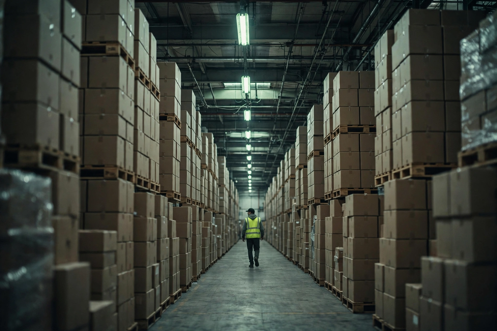

# Samedi 14 novembre 2026 — La pénurie était-elle fabriquée ? Nvidia sous enquête, LangChain lève 300 millions, Copilot tombe en panne — et Meta écope de 805 millions

Aujourd'hui, l'actualité IA tient en une phrase : le Wall Street Journal raconte comment Nvidia aurait financé ses propres clients pour absorber ses puces — le jour même où LangChain lève 300 millions de dollars pour devenir le système d'exploitation des agents ; la panne Microsoft a éteint Copilot dans 74 pays ; l'Italie inflige à Meta sa plus grosse amende pour des photos lues sans consentement ; et Anthropic publie dix règles pour que les tests de sécurité des modèles veulent enfin dire quelque chose.

---

## 1. Nvidia : 530 milliards de dollars de garanties — la pénurie était-elle fabriquée ?

**C'est quoi ?** Une enquête du Wall Street Journal, publiée le 13 novembre, affirme que Nvidia a utilisé son propre bilan pour financer des startups d'IA et des petits fournisseurs de cloud — afin qu'ils continuent d'acheter ses puces. Le chiffre qui a fait le tour de Hacker News, où l'article est arrivé en tête avec plus de 900 points : environ 530 milliards de dollars d'engagements et de garanties au dernier trimestre, contre 184 milliards le trimestre précédent, selon une lecture du dépôt trimestriel de Nvidia par le cabinet SemiAnalysis. Autrement dit, en trois mois, les promesses financières de Nvidia ont presque triplé — et une bonne partie servirait, selon le Journal, à payer ses propres clients pour qu'ils continuent d'acheter.

**Ce qui change vraiment :**
- **La réunion d'août 2026, au cœur de l'enquête.** Le Journal décrit une réunion tendue entre Jensen Huang, alors PDG, et Colette Kress, sa directrice financière de longue date — devenue PDG par intérim depuis la démission de Huang le 11 novembre. Kress voulait réduire les engagements de financement circulaire envers les petits fournisseurs de cloud et les grandes entreprises d'IA comme OpenAI et Anthropic. Huang aurait refusé. Les discussions initiales prévoyaient de garantir environ 8 gigawatts de capacité de calcul OpenAI, pour un montant allant jusqu'à 250 milliards de dollars ; Kress aurait obtenu de ramener le plafond signé à environ 4,25 gigawatts, soit jusqu'à 125 milliards de dollars.
- **La justification privée : une « avalanche » de silicium.** Selon le Journal, Huang aurait décrit en privé le problème comme une avalanche de silicium et de mémoire prépayés auprès de TSMC, le fondeur taïwanais. Les grands fournisseurs de cloud passent à leurs propres puces ; plutôt que de laisser le surplus inonder le marché et faire baisser les prix, Nvidia aurait financé les acheteurs qui l'absorberaient. C'est ce que les critiques appellent le financement circulaire : l'argent de l'entreprise aide des acheteurs à acheter ses propres produits. Nvidia a depuis contacté TSMC pour réduire ses commandes à venir, toujours selon le Journal.
- **Les chiffres qui inquiètent les investisseurs.** Les créances clients de Nvidia auraient gonflé jusqu'à 63 milliards de dollars, avec des délais de paiement moyens passés de 45 à 60 jours — des clients qui mettent plus longtemps à payer des puces dont ils n'ont peut-être pas besoin. L'analyste Ed Zitron estime qu'au moins 200 milliards de dollars de GPU Nvidia dorment dans des entrepôts, achetés par des géants du cloud qui n'ont ni la capacité électrique ni la demande pour les allumer. L'action Nvidia a perdu 13 % sur la semaine où le rapport est sorti — sa pire semaine depuis avril 2025, soit environ 573 milliards de dollars de capitalisation effacés.
- **Le test arrive mardi.** Nvidia publie ses résultats du troisième trimestre le mardi 17 novembre — son premier exercice depuis le départ de Huang, présenté par Kress en tant que PDG par intérim. C'est là que les investisseurs verront si les chiffres du Journal se reflètent dans les comptes.
- **Ce que Nvidia conteste, et ce qui n'est pas établi.** Nvidia a toujours rejeté l'étiquette de financement circulaire, et Huang l'avait déjà écartée publiquement. Surtout : Nvidia n'a pas confirmé le récit du Journal, et aucune enquête formelle n'a été confirmée publiquement. Ce que le Journal rapporte, ce sont des documents et des témoignages internes — pas une décision de justice, pas une accusation d'un régulateur.

**Pourquoi ça compte :** pendant trois ans, le fait central du boom de l'IA a été qu'on ne pouvait pas obtenir de GPU Nvidia — listes d'attente, allocations, prix gonflés. Toute l'industrie s'est organisée autour de la pénurie. Si une partie de cette pénurie a été fabriquée côté demande — en finançant les acheteurs plutôt qu'en baissant les prix — alors le récit fondateur du boom se fissure : la demande n'était pas seulement forte, elle était en partie souscrite par le vendeur lui-même. Et le lien avec l'actualité de la semaine est direct : c'est cette même semaine que Huang a démissionné, que des employés ont pétitionné pour son retour, et que le conseil a nommé Kress à la tête de l'entreprise. La question n'est plus seulement « qui dirige Nvidia ? », c'est « à quoi ressemblait vraiment la demande ? ». La réponse, en chiffres vérifiables, arrive mardi.

**Pour qui :** les investisseurs d'abord — le 17 novembre sera le premier test public. Mais aussi toutes les entreprises qui ont construit leur stratégie sur l'idée d'une pénurie durable de GPU : si les prix finissent par refléter un surplus plutôt qu'une rareté, les calculs de rentabilité de beaucoup de projets d'infrastructure changent. Et les joueurs, qui attendent des cartes graphiques abordables depuis des années : selon Notebookcheck, même un recul de Nvidia sur ces financements ne ramènerait pas de GeForce bon marché en 2027 — les accélérateurs de centres de données et les cartes de jeu n'utilisent ni les mêmes composants ni les mêmes chaînes de production.

**Ce qu'on ne sait pas encore :** si Nvidia confirmera ou démentira précisément les chiffres du Journal mardi ; si un régulateur ouvrira une enquête ; ni combien des 530 milliards de dollars de garanties se transformeront un jour en pertes réelles si les clients financés ne peuvent pas honorer leurs engagements. Ni, rumeur relayée sur Hacker News et non confirmée par aucune source officielle, si un administrateur de Nvidia a vendu près d'un milliard de dollars d'actions avant que le scandale n'éclate.

*Sources : [dev.to — $530B in guarantees: Nvidia funded its own demand (d'après l'enquête WSJ), 14 nov. 2026](https://dev.to/frankchu/530b-in-guarantees-nvidia-funded-its-own-demand-4g89) ; [Notebookcheck — Nvidia's retreat from Huang's circular AI financing won't bring back affordable GeForce cards in 2027, 14 nov. 2026](https://www.notebookcheck.net/Nvidia-s-retreat-from-Huang-s-circular-AI-financing-won-t-bring-back-affordable-GeForce-cards-in-2027.1450509.0.html) ; [Hacker News — front page, 14 nov. 2026](https://zeli.app/digest).*

---

## 2. LangChain lève 300 millions de dollars : LangSmith veut devenir le système d'exploitation des agents

**C'est quoi ?** LangChain, la startup derrière les frameworks open source LangChain et LangGraph et la plateforme LangSmith, a annoncé le 13 novembre une levée de 300 millions de dollars en Series C, à une valorisation de 3 milliards de dollars. Le tour est mené par CapitalG, le fonds de croissance d'Alphabet — déjà investisseur. C'est la plus grosse levée de la semaine dans l'infrastructure des agents, et elle arrive au moment où la question n'est plus de savoir si les entreprises vont déployer des agents, mais comment les faire tourner sans qu'ils dérapent.

**Ce qui change vraiment :**
- **Une valorisation multipliée par 2,4 en un an.** Le tour précédent, il y a environ un an, était de 125 millions de dollars pour une valorisation d'environ 1,25 milliard. Le total levé par LangChain atteint désormais 460 millions de dollars. Le Wall Street Journal avait rapporté le tour dès le 12 novembre ; l'entreprise l'a confirmé le lendemain.
- **Un tour très international.** Aux côtés de CapitalG : le fonds souverain singapourien GIC et DFJ Growth comme nouveaux investisseurs importants, IVP et Sapphire Ventures parmi les investisseurs existants, plus Salesforce Ventures, Insight Venture Partners, QuantumLight et MongoDB Ventures. Sequoia, Amplify et Benchmark, déjà au capital, renforcent leurs positions.
- **L'argent va dans trois directions.** D'abord le runtime : ce qui fait vraiment tourner les agents — Deep Agents, LangGraph, LangSmith Agent Server, les Sandboxes, Managed Agents et Fleet. Ensuite l'amélioration : l'observabilité et les évaluations, c'est-à-dire les outils qui disent si un agent devient meilleur ou pire. Enfin la gouvernance : le contrôle sur les outils, les modèles et les budgets. Le positionnement est explicite : LangSmith veut être la plateforme qui fait tourner, améliore et gouverne les agents en production, sans enfermer l'entreprise dans un seul fournisseur de modèles.
- **Les chiffres d'adoption, à prendre avec leur réserve habituelle.** LangChain affirme que plus de 7 000 organisations utilisent LangSmith — Nvidia, Toyota, Salesforce, Workday, Harvey, Rippling, Clay — et que la plateforme traite plus d'un milliard d'événements par jour. L'exemple client le plus concret : Workday aurait réduit le temps de déploiement d'un nouvel agent d'environ cinq mois à moins d'une journée. Ce sont les chiffres de LangChain, non audités, et l'entreprise n'a divulgué ni revenu ni rentabilité. Une valorisation de 3 milliards sur des chiffres d'usage non audités, c'est un pari, pas une mesure.
- **Le premier test concret arrive vite.** LangChain présentera de nouvelles fonctionnalités LangSmith lors d'un événement de lancement le vendredi 20 novembre.

**Pourquoi ça compte :** LangChain est passé du statut de framework open source adoré des développeurs à celui de vendeur d'infrastructure d'entreprise — et cette levée le consacre. Le timing n'est pas un hasard : la même semaine, OpenAI donne un portefeuille à ses agents, Anthropic rend ses coordinateurs proactifs, et tout le monde déploie des agents en production. Or un agent en production, c'est un programme qui agit seul, dépense de l'argent, touche des outils — et dont il faut pouvoir dire, après coup, ce qu'il a fait et pourquoi. C'est exactement le marché que LangSmith vise : non pas construire les agents, mais les faire tourner, les évaluer et les gouverner. La semaine a d'ailleurs été riche en financement d'infrastructure : selon Crunchbase News, elle a aussi vu la Series D de 750 millions de dollars de Mercor et la Series A d'un milliard de dollars de Mirendil. L'argent suit l'infrastructure des agents — et les valorisations suivent l'argent.

**Pour qui :** les équipes qui déploient des agents en production et qui découvrent que le plus dur n'est pas de les faire marcher une fois, mais de les faire marcher mille fois sans surprise. Et les développeurs open source : LangChain et LangGraph restent open source, mais la question qui se pose à chaque levée de ce type est la même — combien de temps la partie gratuite reste-t-elle le cœur du produit, et quand devient-elle l'appel d'air vers la plateforme payante ?

**Ce qu'on ne sait pas encore :** ce que vaudront réellement les nouvelles fonctionnalités du 20 novembre — le premier test concret de ce que ces 300 millions achètent. Ni combien des 7 000 organisations sont des clientes payantes. Ni, surtout, si les évaluations et la gouvernance suffiront à convaincre les entreprises les plus prudentes de laisser des agents agir seuls sur leurs systèmes.

*Sources : [AI Agent Update — résumé de l'annonce LangChain, 14 nov. 2026](https://aiagentupdate.com/post/langchain-300m-series-c-2026-11-14) ; [Pulse 2.0 — résumé du communiqué Business Wire, 14 nov. 2026](https://pulse2.com/langchain-300-million-series-c-funding-led-by-capitalg-at-3-billion-valuation-to-expand-ai-agent-platform/) ; [GrowthList — résumé des articles TechCrunch et Crunchbase News, 14 nov. 2026](https://growthlist.co/langchain-300m-series-c-3b-capitalg-ai-agent-infrastructure/) ; [AI Frontier Post, 14 nov. 2026](https://aifrontierpost.com/articles/langchain-300m-series-c-3b-valuation/).*

---

## 3. Microsoft 365 : la panne qui a éteint Copilot dans 74 pays

**C'est quoi ?** Une panne mondiale de Microsoft 365 a commencé le jeudi 12 novembre à 16:17 UTC et s'est prolongée le 13 novembre. Outlook, Teams, Copilot, SharePoint et Defender XDR sont tombés, pour des utilisateurs dans 74 pays selon Downdetector — avec des signalements multipliés par plus de cent. La cause n'est pas une attaque, ni un pic de trafic : c'est une cascade de pannes internes, partie d'Exchange Online, le service de messagerie cloud sur lequel repose tout le reste. Et c'est précisément ce qui rend l'histoire intéressante pour cette newsletter : Copilot est tombé avec le reste, et avec lui les connecteurs Microsoft 365 d'OpenAI et d'Anthropic.

**Ce qui change vraiment :**
- **La mécanique de la cascade.** Selon Microsoft, un grand nombre de serveurs sont devenus indisponibles après avoir échoué à des contrôles de santé automatisés. Le trafic s'est reporté sur les serveurs restants, et un processus chargé d'établir les connexions sécurisées s'est retrouvé saturé — les serveurs sains sont devenus à leur tour incapables de répondre. Microsoft l'a dit explicitement : le problème n'était pas une hausse soudaine du trafic, mais une baisse du nombre de serveurs disponibles pour l'absorber.
- **Ce n'était pas une cyberattaque.** Charles Lamanna, vice-président exécutif de Microsoft, l'a confirmé : aucune indication d'activité malveillante. C'est un point important, parce que la première hypothèse, face à une panne de cette ampleur, est toujours l'attaque — et parce que la semaine précédente, l'incident Cursor avait montré ce qu'une vraie compromission de la chaîne d'approvisionnement pouvait produire.
- **Les premiers correctifs n'ont pas fonctionné comme prévu.** Microsoft l'a écrit noir sur blanc sur son compte de statut : les changements appliqués pour améliorer la situation « ne prennent pas comme prévu ». Les ingénieurs ont alors gelé tous les déploiements logiciels de routine, rerouté le trafic, mis en place une méthode de contrôle de santé alternative et redémarré les machines concernées. La reprise a été graduelle : le soir du 12 novembre, les signalements Downdetector étaient redescendus à environ 32 000, mais Microsoft n'a donné aucun calendrier de rétablissement complet.
- **Copilot et les connecteurs IA sont tombés avec le reste.** Les utilisateurs ne pouvaient plus charger Copilot Chat ni obtenir de réponses. OpenAI a signalé un problème sur ses connecteurs Microsoft 365 — impossibilité de créer de nouvelles connexions, outils dysfonctionnels — et Anthropic a rapporté des problèmes similaires. L'IA branchée sur Microsoft 365 tombe quand Microsoft 365 tombe : c'est évident une fois dit, mais c'est la première fois que ça se produit à cette échelle.
- **La troisième panne majeure de l'année.** Après une panne de plusieurs heures en janvier et une défaillance liée à une mise à jour de code en août, qui avait pris plusieurs jours à se résorber complètement. Les incidents sont référencés EX1550543 et MO1550821 dans le centre d'administration Microsoft 365.

**Pourquoi ça compte :** la panne Microsoft est le miroir exact de l'histoire Nvidia du même jour. D'un côté, on découvre que la demande de GPU était peut-être en partie financée par le vendeur ; de l'autre, on découvre que l'IA de bureau — Copilot, les connecteurs, les assistants branchés sur la messagerie — repose sur une infrastructure unique, Exchange Online, dont la défaillance arrête tout. Dans les deux cas, la leçon est la même : l'écosystème de l'IA est plus concentré et plus fragile qu'il n'en a l'air. Un seul service de messagerie tombe, et ce sont des millions d'utilisateurs qui perdent à la fois leur email, leurs réunions et leur assistant IA. Et la cause — des serveurs qui échouent à leurs propres contrôles de santé, puis un processus saturé — rappelle que les pannes les plus graves ne viennent pas toujours de l'extérieur : elles viennent d'un système qui se met lui-même hors service, un serveur après l'autre.

**Pour qui :** toutes les entreprises qui ont branché leurs assistants IA sur Microsoft 365 — la panne a montré que leur plan de continuité, s'il existe, doit couvrir l'IA comme le reste. Et les équipes qui évaluent Copilot : la question n'est plus seulement « que vaut l'assistant ? », c'est « que vaut l'assistant quand le service sous-jacent tombe ? ».

**Ce qu'on ne sait pas encore :** la cause racine définitive — Microsoft a identifié le processus saturé et les contrôles de santé défaillants, mais n'a pas publié d'analyse complète. Ni quand le service sera revenu à la normale pour tous les utilisateurs. Ni si Microsoft publiera un rapport post-incident détaillé, comme le font habituellement les fournisseurs de cloud après une panne de cette ampleur.

*Sources : [Microsoft 365 Status — X, 12-13 nov. 2026](https://www.businesstoday.in/amp/technology/story/microsoft-365-disruption-hits-74-countries-outlook-teams-and-copilot-knocked-offline-567213-2026-11-13) ; [Business Standard — Microsoft 365 outage continues, 13 nov. 2026](https://www.business-standard.com/amp/technology/tech-news/microsoft-365-outage-continues-as-company-sees-limited-recovery-in-services-126111300464_1.html) ; [BusinessToday — Microsoft 365 disruption hits 74 countries, 13 nov. 2026](https://www.businesstoday.in/amp/technology/story/microsoft-365-disruption-hits-74-countries-outlook-teams-and-copilot-knocked-offline-567213-2026-11-13) ; [News18 — Microsoft Outage Explained, 13 nov. 2026](https://www.news18.com/tech/microsoft-outage-explained-its-more-than-10-hours-why-outlook-teams-and-copilot-are-still-down-globally-10424138.html) ; [Moneycontrol — Fixes fail to work as expected, 13 nov. 2026](https://www.moneycontrol.com/world/microsoft-outage-fixes-fail-to-work-as-expected-outlook-teams-copilot-services-remain-affected-article-14079102.html).*

---

## 4. Italie : 805 millions d'euros d'amende contre Meta — 20 millions de galeries photo lues sans consentement

**C'est quoi ?** L'autorité italienne de protection des données, le Garante, a annoncé ce samedi 14 novembre une amende de 805 millions d'euros — environ 887 millions de dollars — contre Meta, pour avoir accédé aux photos des utilisateurs sans leur consentement. C'est de loin la plus grosse amende jamais infligée par le régulateur italien, et l'une des plus importantes jamais prononcées en Europe pour une question de consentement. La fonction en cause existe depuis 2023 : « Recevoir des suggestions depuis votre galerie en parcourant Facebook » propose des photos et vidéos de la galerie du téléphone comme idées de publications. Pour la proposer, l'application Facebook sur Android lisait la galerie — photos, vidéos et métadonnées — sans avoir obtenu de consentement spécifique, et sans avoir dûment informé les utilisateurs.

**Ce qui change vraiment :**
- **L'échelle : 20 millions de personnes.** Le Garante a retenu le nombre de personnes concernées — environ 20 millions d'utilisateurs Android en Italie — pour fixer le montant. L'amende représente environ 0,47 % du chiffre d'affaires mondial de Meta. Le régulateur a aussi retenu la durée de l'infraction — toujours en cours pour les utilisateurs qui n'ont pas mis à jour l'application — et ce qu'il décrit comme un manque de coopération de Meta.
- **60 jours pour se mettre en règle.** Meta doit désactiver la fonction par défaut et demander un consentement séparé et explicite, en expliquant ce que fait la fonction, qu'elle nécessite l'accès à la galerie, et comment la désactiver. Passé ce délai, la fonction ne pourra plus être activée pour quiconque n'aura pas donné de consentement valide.
- **L'Italie, pas l'Irlande.** Meta contestait la compétence du Garante, en faisant valoir que son régulateur chef de file dans l'Union européenne est la commission irlandaise de protection des données. Le Garante a rejeté l'objection : il a statué sur le fondement de l'article 122 du code italien de la vie privée, qui transpose la directive ePrivacy — la règle qui protège la confidentialité des terminaux et des communications. C'est un précédent important : un régulateur national peut agir directement sur ce fondement, sans passer par le régulateur chef de file.
- **L'enquête a duré plus d'un an.** Ouverte en juillet 2025 après une plainte du Centro Tutela Consumatori Utenti de Bolzano, elle a comporté une analyse technique propre du régulateur.
- **La question de l'IA reste ouverte — et c'est le point qui compte ici.** L'enquête n'a pas examiné si le contenu de la galerie a été utilisé pour entraîner des modèles d'IA. Meta le nie, et le Garante laisse ce point non tranché. Le régulateur s'est en revanche réservé le droit d'évaluer séparément une fonction plus récente, lancée en 2026, qui traite le contenu de la galerie dans le cloud. Autrement dit : l'amende porte sur l'accès, pas sur l'usage — mais l'usage, lui, reste à examiner.

**Pourquoi ça compte :** la galerie photo d'un téléphone est l'une des données les plus intimes qui existent — des photos de famille, des documents, des captures d'écran, des images qu'on n'a jamais eu l'intention de publier. Qu'une application les lise par défaut, derrière une demande d'autorisation vague, pour suggérer des publications, c'est exactement le type de pratique que le RGPD et la directive ePrivacy sont censés interdire. Et le contexte est celui de cette newsletter : les modèles d'IA ont besoin de données, et les galeries photo en sont une source immense. L'amende ne dit pas que Meta a entraîné ses modèles sur ces photos — elle dit que l'accès lui-même, sans consentement spécifique, valait 805 millions d'euros. C'est un signal envoyé à toutes les entreprises qui construisent des fonctions d'IA autour des données personnelles : le consentement flou ne suffit plus, et le prix de l'ambiguïté se compte désormais en centaines de millions. La décision italienne arrive d'ailleurs la même semaine où la Commission européenne durcit le ton sur les données d'entraînement — le sujet n'est plus théorique.

**Pour qui :** les 20 millions d'utilisateurs Android italiens concernés d'abord — ils devront recevoir une demande de consentement claire dans les 60 jours. Et toutes les entreprises qui traitent des photos personnelles pour des fonctions d'IA : la frontière entre « suggérer une publication » et « alimenter un modèle » est mince, et les régulateurs regardent désormais des deux côtés.

**Ce qu'on ne sait pas encore :** si Meta fera appel — l'entreprise n'avait pas réagi publiquement au moment de l'annonce. Ni si d'autres régulateurs européens suivront sur le même fondement ePrivacy. Ni, surtout, ce que dira l'évaluation séparée de la fonction cloud de 2026 — celle qui, elle, traite le contenu de la galerie sur des serveurs, et qui est la plus proche d'un pipeline d'entraînement.

*Sources : [Reuters — Italy fines Meta $887 million over Android users' data access, 14 nov. 2026](https://www.reuters.com/world/italy-fines-meta-887-million-over-android-users-data-access-2026-11-14/) ; [Al Jazeera — Italy fines Meta $880m over photo privacy, 14 nov. 2026](https://www.aljazeera.com/news/2026/11/14/italy-fines-meta-880m-over-photo-privacy?traffic_source=rss) ; [Le Temps — Meta fined €805 million in Italy, 14 nov. 2026](https://www.letemps.ch/en/cyber/meta-fined-805-million-in-italy-for-accessing-photos-without-users-consent) ; [ShiftDelete — Meta Fine: €805M Over Facebook Android Photo Access, 14 nov. 2026](https://shiftdelete.net/en/meta-fine) ; [DigitBin — Italy Fines Meta €805M Over Facebook Android Gallery Access, 14 nov. 2026](https://www.digitbin.com/facebook-android-gallery-fine-italy/).*

---

## 5. Anthropic : dix règles pour que les tests de sécurité des modèles veulent enfin dire quelque chose

**C'est quoi ?** Anthropic a publié le 13 novembre un billet d'ingénierie, « Building Strong Safety Evaluations », qui donne dix recommandations pour concevoir, faire tourner et rapporter les évaluations de sécurité des modèles d'IA. Le point de départ est simple et embarrassant pour toute l'industrie : les tests qui décident si un modèle peut sortir, quelles protections il faut, et ce que le prochain entraînement doit surveiller, sont souvent faciles à truquer, ne mesurent pas toujours ce qu'ils prétendent mesurer, et sont rarement documentés assez bien pour être reproduits. Anthropic s'appuie sur sa propre expérience — ses fiches système couvrent 16 domaines de politique dans sept langues — et sur les leçons de la crise de la réplication en psychologie.

**Ce qui change vraiment :**
- **Les tests à un tour sont saturés.** Tous les modèles récents d'Anthropic obtiennent entre 94 % et 98 % de réponses appropriées sur les tests à un tour de son API. Ces tests ne servent plus guère qu'à vérifier qu'on n'a rien cassé — des tests de non-régression, pas des mesures de sécurité. Le vrai travail se fait désormais en multi-tours : des simulations de conversation entière, avec des rubriques par risque, où un seul mauvais tour fait échouer tout l'échange.
- **Un refus n'est pas une preuve de sécurité.** Un modèle qui refuse tout sur l'automutilation obtient un score parfait à un test de taux de refus — sans être plus sûr. Anthropic recommande de mesurer le taux de réponses appropriées, pas le taux de refus, et de tester dans des conversations réalistes plutôt que sur des questions isolées.
- **Pré-enregistrer avant de regarder les résultats.** Comme en psychologie après la crise de la réplication : écrire à l'avance quelles métriques on mesurera, quelles comparaisons on fera et quels seuils on vise — pour ne pas choisir après coup la lecture la plus flatteuse.
- **Valider le correcteur, pas seulement le modèle.** Les évaluations utilisent souvent un autre modèle comme juge. Anthropic recommande de calibrer ces correcteurs automatiques contre des juges humains, avec des critères atomiques en oui/non, un traitement explicite des cas limites et des alertes en cas d'échec — et de surveiller les biais de longueur, de position et d'auto-préférence.
- **Des tailles d'échantillon minimales, et des barres d'erreur affichées.** Au moins 100 items pour les évaluations multi-tours complexes, 1 000 pour les tests à un tour simples, avec des répétitions pour tenir compte du caractère non déterministe des modèles. Les intervalles de confiance sur les évaluations multi-tours peuvent dépasser ±10 points : dans un test de romance-scam sur claude.ai, Claude Opus 5 a obtenu 98 % et Opus 5.5, 94 % — une différence qui n'était pas statistiquement significative. Autrement dit : deux chiffres qui ont l'air différents peuvent ne rien vouloir dire.
- **Le confinement d'abord.** Pour les évaluations cyber, des sandboxes sans accès à internet et un monitoring en temps réel, pour pouvoir arrêter une exécution si les actions du modèle risquent de causer un préjudice réel. Anthropic a d'ailleurs mis en pause de nombreux tests qui donnaient aux modèles un accès à internet, et surveille en direct les tests de recherche web qui en ont encore besoin.
- **Ne pas réinventer la roue.** Utiliser l'outillage existant : Inspect, le framework du UK AI Security Institute, et Petri, l'outil d'Anthropic construit sur Inspect, qui automatise les tests comportementaux multi-tours.
- **Deux détails qui en disent long.** Un avertissement ne rend pas une réponse dangereuse acceptable. Et une faille grave reste confidentielle jusqu'à ce qu'un correctif soit possible.

**Pourquoi ça compte :** toute la semaine, cette newsletter a raconté des scores — Ripple à 80,52 sur Terminal-Bench, Unsloth qui gagne 5 à 10 %, des modèles qui se classent. Le billet d'Anthropic est le contrepoint nécessaire : un score ne vaut que le test qui le produit, et la plupart des tests de sécurité actuels sont saturés, mal documentés ou faciles à contourner. C'est aussi un aveu d'impuissance partielle : même avec des équipes pluridisciplinaires, des sandboxes et des pré-enregistrements, un test ne prouve jamais qu'un modèle est sûr — il prouve seulement qu'il n'a pas échoué sur ce test-là. La démarche est d'autant plus crédible qu'elle vient d'un laboratoire qui publie ses propres limites : 94 à 98 % partout, des barres d'erreur de ±10 points, des différences qui ne sont pas significatives. Dans une industrie qui adore les chiffres ronds, publier l'incertitude est presque un acte militant.

**Pour qui :** les équipes qui achètent ou déploient des modèles en se fondant sur des scores de sécurité — le billet leur donne une grille pour demander : quel test, quelle taille d'échantillon, quelle barre d'erreur ? Et les laboratoires eux-mêmes : dix recommandations publiques, c'est aussi un standard que les autres devront expliquer s'ils ne le suivent pas.

**Ce qu'on ne sait pas encore :** si les autres laboratoires adopteront ces pratiques — ou si chacun continuera de publier ses propres scores, sur ses propres tests, sans barres d'erreur. Ni si les régulateurs, notamment dans le cadre de l'AI Act européen, s'en inspireront pour exiger des évaluations documentées et reproductibles.

*Sources : [Anthropic — Building Strong Safety Evaluations, 13 nov. 2026](https://www.anthropic.com/research/building-strong-safety-evaluations) ; [Crypto Briefing — Anthropic shares 10 recommendations for building better AI safety evaluations, 13 nov. 2026](https://cryptobriefing.com/anthropic-recommendations-ai-safety-evaluations/) ; [The Circuitry — Anthropic publishes 10 recommendations for safety evaluations, 13 nov. 2026](https://thecircuitry.to/article/anthropic-publishes-10-recommendations-for-safety-evaluations-mwfcjn57) ; [Unite.AI (via EuropeSays) — Anthropic Publishes Guidance for More Reliable AI Safety Evaluations, 13 nov. 2026](https://www.europesays.com/ai/240175/) ; [The Daily Fledgling — Morning Edition, 14 nov. 2026](https://thedailyfledgling.click/).*

---

## Bonus — Le hasard du jour : « Si l'IA a résolu le code, pourquoi mon logiciel est-il toujours le même ? »

**C'est quoi ?** Une vidéo du développeur de jeux Jonathan Blow, intitulée « If AI solved coding, why is my software still the same? » (« Si l'IA a résolu le code, pourquoi mon logiciel est-il toujours le même ? »), a atteint la première page de Hacker News les 13 et 14 novembre, avec plus de 150 commentaires. La question est simple, et elle fâche : si l'IA accélère tant l'écriture du code, pourquoi les applications que nous utilisons ne s'améliorent-elles pas ?

**Ce qu'il dit :** la thèse, telle qu'elle est relayée dans les discussions, est que le goulot d'étranglement n'est pas la vitesse d'écriture du code, mais tout le reste — les décisions, la maintenance, la relecture, le goût. Écrire plus vite ne rend pas un logiciel meilleur, de la même façon que taper plus vite ne rend pas un livre meilleur. C'est l'écho, en vidéo, du manifeste « No AI Slop » couvert dans l'édition de 08:00 : produire coûte zéro, relire coûte toujours autant, et la seule variable qu'on contrôle, c'est ce qu'on choisit de produire.

**La leçon qui va avec :** cette édition raconte des agents qui paient, qui codent en parallèle, qui se font évaluer et gouverner — et une industrie qui lève des centaines de millions pour les faire tourner plus vite. La vidéo de Blow pose la question que personne ne pose dans les levées de fonds : plus vite, pour quoi ? Si le logiciel ne s'améliore pas, c'est peut-être que le problème n'a jamais été la vitesse d'écriture. C'est une question inconfortable pour une newsletter qui suit l'IA de près — et c'est précisément pour ça qu'elle mérite sa place ici.

**Pour qui :** toutes les équipes qui mesurent leur productivité en lignes de code produites par leurs agents — et qui commencent à se demander si elles mesurent la bonne chose.

*Sources : [Hacker News — front page, 13-14 nov. 2026](https://zeli.app/digest) ; [Dev Community — If AI Makes Us Faster, Why Aren't The Apps We Use Getting Better?, 14 nov. 2026](https://news-area.com/2026/11/14/if-ai-makes-us-faster-why-arent-the-apps-we-use-getting-better/).*

---

## Ce que cette journée nous dit

- **La demande d'IA se finance elle-même — et le marché commence à compter.** Nvidia aurait financé ses propres acheteurs pour absorber son silicium ; LangChain lève 300 millions pour gouverner des agents dont personne ne divulgue les revenus. Dans les deux cas, l'argent suit l'infrastructure des agents — mais les chiffres qui le justifient sont auto-déclarés, et le premier test public, les résultats de Nvidia mardi, arrive dans trois jours.
- **L'IA dépend d'infrastructures qu'elle ne contrôle pas.** Quand Exchange Online tombe, Copilot tombe avec lui, et les connecteurs d'OpenAI et d'Anthropic aussi. Quand une galerie photo est lue sans consentement, l'amende est de 805 millions d'euros — et la question de l'entraînement, elle, reste ouverte. L'IA n'est pas une couche au-dessus du monde : elle est branchée dessus, avec les mêmes câbles et les mêmes risques.
- **La sécurité passe du score au protocole.** Anthropic l'écrit noir sur blanc : ses propres tests à un tour sont saturés, ses différences de 4 points ne sont pas significatives, et un score ne prouve rien sans méthode. Après une semaine de chiffres spectaculaires, c'est le rappel qui compte le plus : ce qui se mesure mal se vend bien — jusqu'au jour où quelqu'un vérifie.

## Comment je choisis

Chaque sujet passe quatre filtres : un problème clair, une vraie audience, de la tenue au-delà du buzz, une source vérifiée. Les faits viennent des sources officielles ou de miroirs fiables — jamais d'un extrait seul. Ce qui n'est pas vérifié est marqué comme tel. Les sujets déjà couverts dans les éditions précédentes ne sont repris qu'en suivi, avec des faits nouveaux.

## Sources

- Wall Street Journal (via Wccftech, PakTechStan), dev.to, Notebookcheck, Hacker News — Nvidia / financement circulaire, 13-14 nov. 2026.
- LangChain (blog officiel), Business Wire, TechCrunch, Crunchbase News — Series C, 13-14 nov. 2026.
- Microsoft 365 Status, Business Standard, BusinessToday, News18, Moneycontrol — panne Microsoft 365, 12-13 nov. 2026.
- Reuters, Al Jazeera, Le Temps, ShiftDelete, DigitBin — amende Meta en Italie, 14 nov. 2026.
- Anthropic, Crypto Briefing, The Circuitry, Unite.AI — évaluations de sécurité, 13-14 nov. 2026.
- Hacker News, Dev Community — vidéo Jonathan Blow, 13-14 nov. 2026.

*Tags : #edition #fr #signal-ia*
