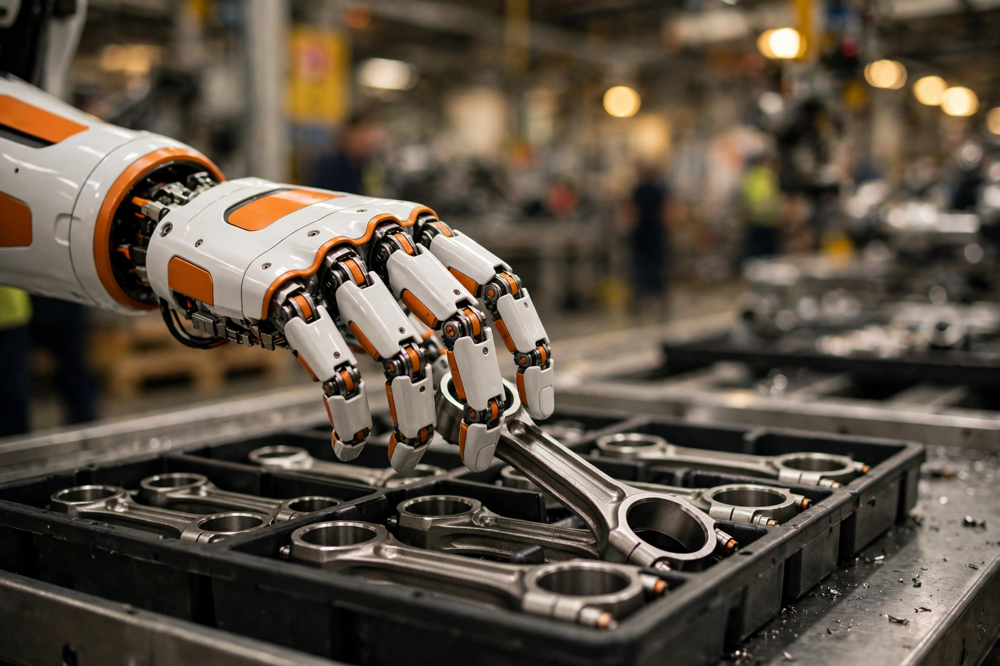

# Saturday, November 14, 2026 — Humanoids on Mercedes assembly lines, 159,000 apps leaking, and AI that costs 180× more in Hindi

*Signal IA newsletter, 4:00 PM edition, English version.*

Today's AI news in one sentence: Google puts humanoids on real Mercedes assembly lines while 159,000 AI-built apps turn out to be open to everyone; Antigravity teaches its agents to orchestrate themselves in Python; a study shows the same sentence costs up to 180 times more energy in Bengali than in English; and $11.4 million of Nvidia hardware vanishes between Oakland and Texas, while the board's investigation into Jensen Huang continues.

---

## 1. Gemini Robotics 2.5: humanoids on real Mercedes lines

**What is it?** On November 10, Google DeepMind introduced Gemini Robotics 2.5, its most capable vision-language-action model to date — a model that sees what's in front of it, understands an instruction in plain language, and turns it into a robot's movements. The model was evaluated on more than 200 distinct tasks, from serving food with tongs to tying a bow on a gift box to pipetting liquid. But the number that travelled this week, and pushed the story to the top of Product Hunt this Saturday, is elsewhere: on active Mercedes-Benz production lines in Hungary and Germany, Apptronik's Apollo 2 humanoid, driven by this model, sorted automotive parts with a 96% success rate.

**What actually changes:**
- **This is not a lab demo.** The pilot ran on active lines in Kecskemét, Hungary, and Sindelfingen, Germany. The task — automotive kitting — means sorting individual parts from bulk bins into organized trays, in the exact order each vehicle on the line needs. It's repetitive, precise work, historically hard to automate because parts are never twice in the same position.
- **Dexterity is the real story.** Apollo 2 uses a five-finger SharpaWave hand with 22 degrees of freedom; the model also runs on the Franka Duo platform, with two arms and two-finger grippers. DeepMind claims success rates 30% to 100% higher and execution speeds 20% to 30% faster than Gemini Robotics 2, depending on task type — DeepMind's figures, whose detailed baselines are not published.
- **Two models, two jobs.** The Mercedes demonstration pairs Gemini Robotics ER, which tracks workflow state — where the task stands, what remains — with Gemini Robotics 2.5, which drives the hand and arm. It's the same two-layer architecture as software agents: a planner that reasons, an executor that acts.
- **Safety ships with it.** DeepMind is releasing ASIMOV-Jailbreak, an open benchmark of adversarial prompts for robots — the equivalent, for a robot arm, of chatbot jailbreak tests. The question is no longer theoretical: what happens when you tell a robot to do something dangerous?
- **Nobody can try it.** Gemini Robotics 2.5 is rolling out to DeepMind's robotics partners — Agile Robots, Apptronik, Boston Dynamics, and 100+ trusted testers. No public API, no price, no general availability date. Training was accelerated by Gemini 4 Argon, Google's most powerful reasoning model.

**Why it matters:** this week was a crossing point. On November 13, this newsletter reported that OpenAI was dissolving its dedicated robotics team, betting that its general models would eventually drive robots. On November 10, Google did seemingly the opposite — a specialized model, deployed on real factory lines. Both bets can be right at the same time: robotics is becoming an application of frontier models, and at the same time a discipline of its own, with its own safety benchmarks and industrial pilots. The 96% figure deserves its usual caveat: DeepMind publishes neither the trial count nor its failure criteria — 24 successes out of 25 and 960 out of 1,000 both round to 96%. But the location is verifiable: active Mercedes lines, not a demonstration warehouse.

**Who it's for:** manufacturers first — kitting is one of the most labor-intensive jobs in automotive production. And robotics developers: DeepMind's message is that generalist dexterity is arriving, but through partners, not through an open API.

**What we don't know yet:** how many trials hide behind the 96%; what the model is worth over a full production day, with breakdowns, part changes, and human interventions; or when — or at what price — a developer outside the partner circle will be able to use it.

*Sources: [Google DeepMind — Gemini Robotics 2.5: Accelerating Physical Intelligence, Nov 10, 2026](https://deepmind.google/blog/gemini-robotics-2-5-accelerates-real-world-physical-intelligence/) ; [explainx.ai — Gemini Robotics 2.5: 96% Kitting, New Safety Bench, Nov 10, 2026](https://explainx.ai/blog/gemini-robotics-2-5-mercedes-kitting-asimov-jailbreak-2026) ; [dev.to — Gemini Robotics 2.5 Put Humanoids on a Real Mercedes Line, Nov 11, 2026](https://dev.to/paullovelace/gemini-robotics-25-put-humanoids-on-a-real-mercedes-line-96-success-and-one-big-catch-5gje) ; [TechTimes — Gemini Robotics 2.5 Reports 96% Success Sorting Mercedes Car Parts, Nov 11, 2026](https://www.techtimes.com/articles/330432/20261111/gemini-robotics-25-reports-96-success-sorting-mercedes-car-parts-publishes-no-trial-count.htm) ; [Product Hunt, Nov 14, 2026](https://www.producthunt.com/).*

---

## 2. Lovable: 159,000 apps scanned, passports readable with no login

**What is it?** A study by the German security firm Crissy Field, conducted with the business daily Handelsblatt and published November 2–3, scanned 159,041 apps built with Lovable, the AI app builder — and found personal data readable by anyone, with no login. The story reached number two on Hacker News this Saturday, with 487 points. The worst of it: more than 1,000 identity records with passport numbers, more than 200,000 private chat messages, 80,000 user profiles — all accessible through plain read-only requests, the same kind the app itself makes to work.

**What actually changes:**
- **The scale of the scan.** The researchers pulled the projects from the public Common Crawl archive — apps created between December 2025 and September 2026. Of roughly 34,500 that use Supabase as their backend, 24,664 returned database records with no authentication at all. Email addresses were readable on 7,403 sites, spread across more than 10,500 tables.
- **The worst cases, one by one.** One service provider exposed more than 1,000 identity records — passport numbers, expiry dates, nationalities. A German lifestyle forum exposed more than 200,000 chat messages and 80,000 profiles, with names, email addresses, and dates of birth. A CRM-style app exposed around 280,000 customer emails. The researchers downloaded only samples: the numbers are floors, not totals.
- **The cause is a single setting.** Most Lovable apps store their data in Supabase, a hosted Postgres database. The only thing standing between the app's public key and the data is Row-Level Security — rules that say who can read what. In thousands of AI-generated apps, those rules were never switched on. Lovable's servers were not breached; each app simply left its own door open.
- **This is not the first time.** In March 2025, an earlier scan found 170 open sites out of 1,645 examined — a flaw recorded as CVE-2025-48757, critical severity (9.3 out of 10). Lovable responded by adding an automated Security Scanner and an AI-driven Security Reviewer, meant to catch exactly this kind of misconfiguration before shipping. Eighteen months later, the same problem shows up at ten times the scale.
- **Lovable's position.** The company told Handelsblatt the problem is industry-wide and that customers are contractually responsible for their own apps and data. That's legally defensible — and practically untenable: Lovable's users are precisely non-developers who don't know what Row-Level Security is.

**Why it matters:** this is the exact reverse of the promise of AI app builders, told all week in this newsletter: anyone can now build an app. The problem is that "anyone" now includes thousands of people deploying databases without knowing a database needs securing. The parallel with Thursday's Microsoft outage is direct: in both cases, the fragility comes not from an attack, but from a misconfiguration nobody checked. And the question of responsibility applies to the whole category — Lovable, but also its competitors: when a tool sells "build an app without coding," who is responsible when the app leaks? Lovable's answer — the customer — sounds like a carmaker saying the brakes are the driver's business.

**Who it's for:** anyone who built an app with Lovable or an equivalent tool — the check to run comes down to one question: is Row-Level Security enabled on every table? And companies whose teams use these tools for prototypes that end up in production with real customer data.

**What we don't know yet:** whether the exposed data was exploited — the researchers say explicitly they cannot establish that. Nor how many sites fixed their settings since the report. Nor whether European regulators, who just fined Meta €805 million for photos read without consent, will take an interest in thousands of small leaks that, added up, affect hundreds of thousands of people.

*Sources: [Handelsblatt / Crissy Field — Lovable research report, Nov 2, 2026](https://inigra.eu/blog/is-lovable-safe/) ; [iFynx — Lovable Apps Data Exposure: 7,403 Sites, Supabase RLS and a Checklist, Nov 3, 2026](https://medium.com/@ifynx-publish/lovable-apps-data-exposure-7-403-sites-supabase-rls-and-a-checklist-ifynx-12e7cd88b933) ; [Startup Fortune — Lovable AI Apps Left Passport and Payment Data Open to Anyone, Nov 3, 2026](https://startupfortune.com/lovable-ai-apps-left-passport-and-payment-data-open-to-anyone/) ; [FixForward Labs — Is My Lovable App Leaking Data?, Nov 3, 2026](https://fixforwardlabs.com/blog/is-my-lovable-app-leaking-data) ; [Hacker News — front page, Nov 14, 2026](https://zeli.app/digest).*

---

## 3. Google Antigravity: agents orchestrate themselves in Python

**What is it?** On November 13, Google shipped a feature called Dynamic Workflows in Antigravity, its agent coding platform: the `/run-workflow` command has the agent write a Python script — reviewable before it runs — that coordinates subagents in parallel or in sequence, with structured handoffs validated by JSON Schema. The script can be saved and run again. It's the third orchestration building block Google has shipped in four days, after `/swarm` on November 10 and Orchestrator on November 12. To mark the week, the team also reset everyone's Gemini quota on Antigravity.

**What actually changes:**
- **The coordinator becomes code.** Until now, coordinating several agents meant a long conversation in which the plan drifted from turn to turn — the familiar "prompt drift." With Dynamic Workflows, the plan is a program: named phases, parallel or sequential execution, typed outputs. A developer can read it, fix it, version it. It's the same move as Anthropic's evaluations covered at noon: replace trust with something verifiable.
- **Three ways to orchestrate, three distinct tools.** `/swarm` (Nov 10) has agents negotiate on a shared board. Orchestrator (Nov 12) dynamically switches between Gemini 4 Carbon and Gemini 4 Hydrogen inside one session — Carbon to plan, Hydrogen to execute — with, according to Google, near-Carbon success on Terminal-Bench 4.1, 24% lower quota use, and 19% faster completion. Dynamic Workflows (Nov 13) hands coordination to a script. Three answers to three different problems: negotiation, model choice, flow control.
- **Access conditions.** Dynamic Workflows is available with Google AI Pro and Ultra, in the Antigravity app and its CLI. Orchestrator is limited to Ultra subscribers for now. Enterprises can access both models through Gemini for Business.
- **The quota reset.** Varun Mohan, who leads Antigravity, announced the team was resetting everyone's Gemini quota on Antigravity to mark the week of shipping. No official post says how long the reset lasts — treat it as a short window.

**Why it matters:** this week showed that the agent question is no longer "which model?" but "how do we make them work together without derailing?" LangChain raised $300 million to govern agents in production; Anthropic published ten rules so safety tests mean something; Google shipped three orchestration mechanisms in four days. The common thread: the industry is moving from demonstration to control — reviewable scripts, typed outputs, measured handoffs. The Dynamic Workflows Python script is a symbol of that shift: when an agent's plan becomes code, it becomes testable, reusable, auditable. It's also an indirect answer to the Jonathan Blow video covered at noon: if software isn't getting better despite AI, maybe it's because nobody controls what agents produce at scale.

**Who it's for:** developers using Antigravity who already coordinate several agents — the Python workflow is built for them. And teams evaluating agent coding platforms: the ability to review the plan before execution is becoming a selection criterion, alongside the model itself.

**What we don't know yet:** what Dynamic Workflows is worth on real multi-day projects — the announcements talk about coordination, not measured results. Nor how long the quota reset lasts. Nor whether Google will open these features to free plans, or whether orchestration stays a paid argument.

*Sources: [Google Antigravity — blog and changelog, Nov 12–13, 2026](https://antigravity.google/blog/gemini-4-hydrogen-in-google-antigravity) ; [AlphaSignal — Google Antigravity Ships Dynamic Workflows to Run Parallel AI Coding Agents, Nov 13, 2026](https://alphasignal.ai/news/google-antigravity-ships-dynamic-workflows-to-run-parallel-ai-coding-agents) ; [Unite.AI — Google Antigravity Rolls Out Orchestrator for Dynamic Model Handoffs, Nov 12, 2026](https://www.unite.ai/google-antigravity-rolls-out-orchestrator-for-dynamic-model-handoffs/) ; [Antigravity changelog, Nov 2026](https://www.gradually.ai/en/changelogs/antigravity/).*

---

## 4. AI uses up to 180× more energy on non-English text

**What is it?** A University of Michigan study, presented at the EMNLP 2026 conference and publicized on November 5, measured the energy consumed by three open models — Alibaba's Qwen 3, Google's Gemma 3, and Meta's Llama 3.1 — to answer equivalent questions in several languages. The result: generating non-English text can cost 1.4 to 180 times more energy than English. The story reached the Hacker News front page this Saturday, with 155 points. And the bill isn't only energetic: answers in those languages are also less accurate.

**What actually changes:**
- **The numbers by language.** Hindi, spoken by hundreds of millions of people, costs 7.9 times more energy than an equivalent question in English. Bengali: 15.3 times. Western European languages stay at 2 times or less. The worst measured case — 180 times — involves languages with little digital presence, whose writing systems don't use the Latin alphabet.
- **The mechanism is known.** For the same idea, a text in Hindi or Bengali becomes many more tokens — the chunks models cut text into — than in English. Every token costs compute, so it costs energy. The languages hit hardest are those whose scripts diverge from Latin and whose training content is scarcest.
- **Less accurate, on top of costing more.** The study finds the languages that consume the most energy are also the ones where outputs are worst. Cost and quality move together — in the wrong direction. The researchers speak of reinforcing existing global inequalities: those with the least access to AI in English pay the most, in energy and in quality, to use it in their own language.
- **A measurement, not an estimate.** The researchers measured real consumption on the university's Great Lakes high-performance computing cluster, on three open models. The study was partly funded by the National Science Foundation and DARPA. The paper: "The Language–Energy Divide: Measuring Energy Costs of Multilingual LLM Inference," by Naihao Deng and colleagues.

**Why it matters:** all week, this newsletter talked about prices — $1.50 per million tokens for Gemini 4 Hydrogen, $0.28 for ERNIE 5.5 Flash, quotas and subscriptions. The Michigan study shows those prices are misleading averages: the real cost of a question depends on the language it's asked in, and the gap can reach a factor of 180. For the hundreds of millions of people who speak Hindi or Bengali, AI isn't just worse — it's structurally more expensive, in energy and therefore in money, the moment you leave English. It's also a blind spot in debates about AI's energy consumption: we count datacenters, rarely the language of the users.

**Who it's for:** French speakers first — French stays in the low range, at 2 times or less, but the lesson applies to every non-English language. And companies deploying AI in several languages: the cost per question isn't the same in Paris and in Dhaka, and budgets should reflect that.

**What we don't know yet:** whether closed models — GPT, Claude, Gemini — show the same gaps, since the study covers only three open models. Nor whether labs are working to close the gap, for instance with tokenizers better adapted to non-Latin scripts. Nor how long it will take for energy efficiency to become a model comparison criterion, alongside accuracy.

*Sources: [University of Michigan Engineering — Generative AI uses more energy on non-English text, Nov 5, 2026](https://news.engin.umich.edu/2026/11/generative-ai-uses-more-energy-on-non-english-text/) ; [Tech Xplore — Generative AI uses more energy on non-English text, Nov 5, 2026](https://techxplore.com/news/2026-11-generative-ai-energy-english-text.html) ; [Futurity — Generative AI burns more energy on non-English text, Nov 9, 2026](https://www.futurity.org/generative-ai-energy-non-english-text-3352352/) ; [Hacker News — front page, Nov 14, 2026](https://zeli.app/digest).*

---

## 5. Nvidia: $11.4 million of hardware stolen in transit — and the board investigation continues

**What is it?** Six pallets of Nvidia hardware, worth $11.4 million, vanished between Oakland, California, and Fort Worth, Texas. The truck that picked them up on August 29 bore the logo of a food hauler. Its tracking signal was lost in San Bernardino County. The complaint wasn't filed until September 13, and the story only surfaced on November 5 — it reached the Hacker News front page this Saturday with 332 points. No arrests, nothing recovered, and nobody knows which chips were in the pallets. Meanwhile, the board's independent investigation into Jensen Huang continues — and quarterly results land on Tuesday.

**What actually changes:**
- **An ordinary theft, an extraordinary target.** The truck collected the cargo on schedule, bearing a food-transport logo — a disguise shippers adopt to make high-value cargo less identifiable. Oakland police are treating the case as grand theft. Neither police nor the reporting identifies which Nvidia products were in the pallets: the $11.4 million figure is a cargo value, not a chip inventory.
- **The context is a surge.** Verisk CargoNet recorded 19 thefts worth $1 million or more in Q3 2026, many involving electronics and datacenter materials. The FBI published a notice as early as April 30 about surging "cyber-enabled" cargo theft. AI chips have become a target like pharmaceuticals or consumer electronics before them — with one difference: their value per kilo exceeds almost anything else on the road.
- **The board investigation is moving, too.** On November 8, Nvidia's board opened an independent investigation, after reports that Jensen Huang had been the target of a foreign intelligence effort. On November 10, the independent directors retained Joon H. Kim, former acting US Attorney for the Southern District of New York, and the firm Wachtell Lipton to run it. On November 11, Huang resigned and Colette Kress became interim CEO. According to The Information, the investigation continues despite his departure. The board said it has "no reason to believe" national security or Nvidia secrets were compromised — a starting position, not a finding.
- **The week ahead is loaded.** Nvidia reports third-quarter results on Tuesday, November 17 — the first quarter presented by Kress. Three House committee chairs have requested a closed-door briefing with Huang for November 18. The New York Times allegations — a Megaspeed executive in Singapore allegedly recruited to gather information on Huang, and the company allegedly buying about $4.8 billion of hardware between June 2024 and February 2026 — remain unconfirmed by Nvidia, and Beijing denies them.

**Why it matters:** it's the same story, told twice in the same week, from two angles. At noon, the Wall Street Journal investigation showed GPU demand may have been partly financed by the seller itself. This afternoon, a truck disappears with $11.4 million of hardware, and the board investigates its former CEO. On one side, a shortage we now wonder was manufactured; on the other, hardware so valuable it's stolen on the road. Both stories say the same thing: the AI supply chain has become a matter of physical security and governance, not just a foundry problem. And the numerical test arrives Tuesday, with the quarterly results.

**Who it's for:** investors first — Tuesday will be the first public test of the numbers since the resignation. And everyone shipping datacenter hardware: cargo theft has become an ordinary operational risk of the AI industry.

**What we don't know yet:** which chips were in the six pallets, and whether they'll ever resurface on a secondary market. Nor what the board investigation will conclude — no timetable has been published. Nor whether the Wall Street Journal's $530 billion in guarantees will show up in Tuesday's accounts.

*Sources: [Mercury News / Nate Gartrell — Police investigating $11.4 million Nvidia cargo theft, Nov 5, 2026](https://www.inboundlogistics.com/articles/nvidia-cargo-theft-oakland-fort-worth/) ; [Ars Technica — Nvidia hardware worth $11.4M vanished between Oakland and Texas, Nov 6, 2026](https://arstechnica.com/gadgets/2026/11/nvidia-hardware-worth-11-4m-vanished-between-oakland-and-texas/) ; [Inbound Logistics — Nvidia Cargo Theft, Nov 10, 2026](https://www.inboundlogistics.com/articles/nvidia-cargo-theft-oakland-fort-worth/) ; [Nvidia Newsroom — Statement from NVIDIA Board of Directors, Nov 8, 2026](https://nvidianews.nvidia.com/news/statement-from-nvidia-board-of-directors) ; [MLQ — Nvidia's board: the 10 directors deciding the company's future, Nov 13, 2026](https://mlq.ai/news/nvidias-board-the-10-directors-deciding-the-companys-future-after-jensen-huang/) ; [Hacker News — front page, Nov 14, 2026](https://zeli.app/digest).*

---

## Bonus — The random pick of the day: "I deleted 2,000 lines of code and shipped zero new features"

**What is it?** An essay published this November 14 on DEV Community, titled "I deleted 2,000 lines of code and shipped zero new features. It was the best thing I did all year." The author tells the story of his biggest pull request of the year: 2,000 lines deleted, not one added. Under the pile of defensive code, a simple bug: the app's write path acknowledged receipt before actually persisting the data. The fix was about twenty lines; the rest was scar tissue grown around the problem.

**The lesson that comes with it:** the author's thesis is that the industry worships the author — the one who generates, ships, delivers — and forgets the deleter. "An author with no counterweight doesn't hand you a clean codebase." The author now builds an agent platform, and deletion is his founding thesis. It's the code-side echo of the Jonathan Blow video covered at noon: if software isn't getting better despite AI, maybe it's because we measure production and never subtraction. And there is a verified counterpoint: a case study from October 21 shows a developer deleting 19,000 lines of dead compiler code with LLM assistance — but with strict verification, which filtered out 12% of initial false positives that would have broken the build. Delete with AI, yes — but verify every line, the way this newsletter verifies every fact.

**Who it's for:** every team measuring productivity in lines produced by their agents — and starting to wonder if they're measuring the right thing.

*Sources: [DEV Community — I deleted 2,000 lines of code and shipped zero new features, Nov 14, 2026](https://dev.clauneck.workers.dev/infoinlet1/i-deleted-2000-lines-of-code-and-shipped-zero-new-features-it-was-the-best-thing-i-did-all-year-11m4) ; [Emergent — Deleting 19k Lines of Dead Compiler Code With LLM Assist, Oct 21, 2026](https://emergent.sh/news/deleting-19k-lines-dead-compiler-code-llm).*

---

## What today tells us

- **The physical catches up with the digital.** Humanoids sort parts on Mercedes lines, trucks vanish with $11.4 million of chips, and databases of AI-generated apps sit open to everyone. AI is no longer software: it has a body, a logistics chain, and doors people forget to lock.
- **Orchestration becomes the job.** Google ships three agent-coordination mechanisms in four days, LangChain raises $300 million to govern them, Anthropic publishes ten rules to test them. The question is no longer which model, but how agents work together — with reviewable plans and verifiable outputs.
- **The cost of AI depends on the language you speak.** Up to 180 times more energy for the same question outside English, with worse answers on top. Vendor prices are averages — and averages hide inequalities.

## How I choose

Every subject passes four filters: a clear problem, a real audience, staying power beyond the launch buzz, a verified source. Facts come from official sources or reliable mirrors — never from a snippet alone. What isn't verified is marked as such. Subjects already covered in previous editions return only as follow-ups, with new facts.

## Sources

- Google DeepMind, explainx.ai, dev.to, TechTimes — Gemini Robotics 2.5, Nov 10–11, 2026.
- Handelsblatt / Crissy Field, iFynx, Startup Fortune, FixForward Labs — Lovable, Nov 2–3, 2026.
- Google Antigravity, AlphaSignal, Unite.AI — Dynamic Workflows and Orchestrator, Nov 12–13, 2026.
- University of Michigan, Tech Xplore, Futurity — multilingual energy, Nov 5–9, 2026.
- Mercury News, Ars Technica, Inbound Logistics, Nvidia Newsroom, MLQ — Nvidia cargo theft and board investigation, Nov 5–13, 2026.
- DEV Community, Emergent — code deletion, Oct 21 and Nov 14, 2026.
- Hacker News, Product Hunt — front pages, Nov 14, 2026.

*Tags: #edition #en #signal-ia*
