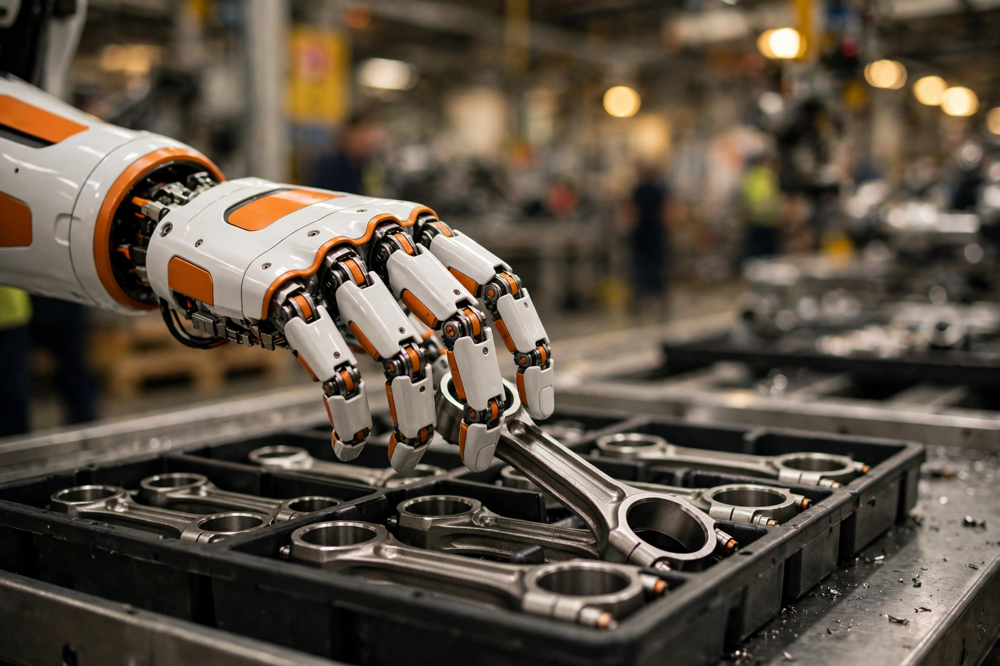

# Samedi 14 novembre 2026 — Des humanoïdes sur les chaînes Mercedes, 159 000 applis qui fuient, et l'IA qui coûte 180 fois plus cher en hindi

*Édition 1600 de la newsletter Signal IA, version française.*

Aujourd'hui, l'actualité IA tient en une phrase : Google met des humanoïdes sur de vraies chaînes de montage Mercedes pendant que 159 000 applications construites par IA se révèlent ouvertes à tout le monde ; Antigravity apprend à ses agents à s'orchestrer en Python ; une étude montre que la même phrase coûte jusqu'à 180 fois plus d'énergie en bengali qu'en anglais ; et 11,4 millions de dollars de matériel Nvidia disparaissent entre Oakland et le Texas, pendant que l'enquête du conseil sur Jensen Huang continue.

---

## 1. Gemini Robotics 2.5 : des humanoïdes sur de vraies chaînes Mercedes

**C'est quoi ?** Google DeepMind a présenté le 10 novembre Gemini Robotics 2.5, son modèle vision-langage-action le plus capable à ce jour — un modèle qui voit ce qu'il y a devant lui, comprend une consigne en langage naturel, et en déduit les mouvements d'un robot. Le modèle a été évalué sur plus de 200 tâches distinctes, de servir de la nourriture avec des pinces à faire un nœud sur un paquet cadeau, en passant par pipeter un liquide. Mais le chiffre qui a fait le tour de la semaine, et qui a propulsé le sujet en tête de Product Hunt ce samedi, est ailleurs : sur des lignes de production Mercedes-Benz en activité, en Hongrie et en Allemagne, l'humanoïde Apollo 2 d'Apptronik, piloté par ce modèle, a trié des pièces automobiles avec 96 % de réussite.

**Ce qui change vraiment :**
- **Ce n'est pas une démo de laboratoire.** Le pilote s'est déroulé sur des lignes actives, à Kecskemét en Hongrie et à Sindelfingen en Allemagne. La tâche — le kitting automobile — consiste à trier des pièces individuelles en vrac pour les ranger dans des bacs organisés, dans l'ordre exact dont chaque véhicule sur la ligne a besoin. C'est un travail répétitif, précis, et historiquement difficile à automatiser parce que les pièces ne sont jamais deux fois dans la même position.
- **La dextérité est le vrai sujet.** Apollo 2 utilise une main SharpaWave à cinq doigts et 22 degrés de liberté ; le modèle tourne aussi sur la plateforme Franka Duo, à deux bras et pinces à deux doigts. DeepMind affirme des taux de réussite supérieurs de 30 % à 100 % et des vitesses d'exécution supérieures de 20 % à 30 % par rapport à Gemini Robotics 2, selon le type de tâche — des chiffres DeepMind, dont les baselines détaillées ne sont pas publiées.
- **Deux modèles, deux rôles.** La démonstration Mercedes associe Gemini Robotics ER, qui suit l'état du workflow — où en est la tâche, ce qui reste à faire — et Gemini Robotics 2.5, qui pilote la main et le bras. C'est la même architecture en deux couches que pour les agents logiciels : un planificateur qui raisonne, un exécutant qui agit.
- **La sécurité est livrée avec.** DeepMind publie ASIMOV-Jailbreak, un benchmark ouvert de prompts adversariaux pour robots — l'équivalent, pour un bras robotique, des tests de jailbreak des chatbots. La question n'est plus théorique : que se passe-t-il quand on dit à un robot de faire quelque chose de dangereux ?
- **Personne ne peut l'essayer.** Gemini Robotics 2.5 est déployé chez les partenaires robotiques de DeepMind — Agile Robots, Apptronik, Boston Dynamics, et plus de 100 testeurs de confiance. Pas d'API publique, pas de prix, pas de date de disponibilité générale. L'entraînement a été accéléré par Gemini 4 Argon, le modèle de raisonnement le plus puissant de Google.

**Pourquoi ça compte :** la semaine a été celle d'un croisement. Le 13 novembre, cette newsletter racontait qu'OpenAI dissolvait son équipe robotique dédiée, pariant que ses modèles généraux finiraient par piloter des robots. Le 10 novembre, Google faisait exactement l'inverse en apparence — un modèle spécialisé, déployé sur des lignes d'usine réelles. Les deux paris peuvent avoir raison en même temps : la robotique devient une application des modèles frontières, et en même temps un métier à part entière, avec ses propres benchmarks de sécurité et ses propres pilotes industriels. Le chiffre de 96 % mérite sa réserve habituelle : DeepMind ne publie ni le nombre d'essais ni ses critères d'échec — 24 réussites sur 25 et 960 sur 1 000 donnent le même 96 %. Mais le lieu, lui, est vérifiable : des lignes Mercedes en activité, pas un entrepôt de démonstration.

**Pour qui :** les industriels d'abord — le kitting est l'une des tâches les plus coûteuses en main-d'œuvre dans l'automobile. Et les développeurs de robotique : le message de DeepMind est que la dextérité généraliste arrive, mais par les partenaires, pas par une API ouverte.

**Ce qu'on ne sait pas encore :** combien d'essais se cachent derrière les 96 % ; ce que vaut le modèle sur une journée entière de production, avec des pannes, des changements de références et des interventions humaines ; ni quand — ni à quel prix — un développeur hors du cercle des partenaires pourra l'utiliser.

*Sources : [Google DeepMind — Gemini Robotics 2.5: Accelerating Physical Intelligence, 10 nov. 2026](https://deepmind.google/blog/gemini-robotics-2-5-accelerates-real-world-physical-intelligence/) ; [explainx.ai — Gemini Robotics 2.5: 96% Kitting, New Safety Bench, 10 nov. 2026](https://explainx.ai/blog/gemini-robotics-2-5-mercedes-kitting-asimov-jailbreak-2026) ; [dev.to — Gemini Robotics 2.5 Put Humanoids on a Real Mercedes Line, 11 nov. 2026](https://dev.to/paullovelace/gemini-robotics-25-put-humanoids-on-a-real-mercedes-line-96-success-and-one-big-catch-5gje) ; [TechTimes — Gemini Robotics 2.5 Reports 96% Success Sorting Mercedes Car Parts, 11 nov. 2026](https://www.techtimes.com/articles/330432/20261111/gemini-robotics-25-reports-96-success-sorting-mercedes-car-parts-publishes-no-trial-count.htm) ; [Product Hunt, 14 nov. 2026](https://www.producthunt.com/).*

---

## 2. Lovable : 159 000 applis scannées, des passeports lisibles sans connexion

**C'est quoi ?** Une étude du cabinet allemand de sécurité Crissy Field, réalisée avec le quotidien économique Handelsblatt et publiée les 2 et 3 novembre, a scanné 159 041 applications construites avec Lovable, le générateur d'applications par IA — et trouvé des données personnelles lisibles par n'importe qui, sans connexion. Le sujet est remonté en deuxième position de Hacker News ce samedi, avec 487 points. Le pire : plus de 1 000 dossiers d'identité avec numéros de passeport, plus de 200 000 messages de chat privés, 80 000 profils d'utilisateurs — le tout accessible par de simples requêtes en lecture, les mêmes que l'application elle-même fait pour fonctionner.

**Ce qui change vraiment :**
- **L'échelle du scan.** Les chercheurs ont tiré les projets de l'archive publique Common Crawl — des applications créées entre décembre 2025 et septembre 2026. Sur environ 34 500 d'entre elles qui utilisent Supabase comme base de données, 24 664 renvoyaient des enregistrements sans aucune authentification. Des adresses email étaient lisibles sur 7 403 sites, répartis sur plus de 10 500 tables.
- **Les pires cas, un par un.** Un prestataire de services exposait plus de 1 000 dossiers d'identité — numéros de passeport, dates d'expiration, nationalités. Un forum allemand de lifestyle exposait plus de 200 000 messages de chat et 80 000 profils, avec noms, adresses email et dates de naissance. Une application de type CRM exposait environ 280 000 adresses email de clients. Les chercheurs n'ont téléchargé que des échantillons : les chiffres sont des planchers, pas des totaux.
- **La cause tient en un réglage.** La plupart des applications Lovable stockent leurs données dans Supabase, une base Postgres hébergée. La seule chose qui sépare la clé publique de l'application et les données, c'est la Row-Level Security — des règles qui disent qui peut lire quoi. Dans des milliers d'applications générées par IA, ces règles n'ont jamais été activées. Les serveurs de Lovable n'ont pas été piratés ; chaque application a simplement laissé sa porte ouverte.
- **Ce n'est pas la première fois.** En mars 2025, un premier scan avait trouvé 170 sites ouverts sur 1 645 examinés — une faille enregistrée comme CVE-2025-48757, de sévérité critique (9,3 sur 10). Lovable avait réagi en ajoutant un Security Scanner automatisé et un Security Reviewer piloté par IA, censés détecter exactement ce type de mauvaise configuration avant la mise en production. Dix-huit mois plus tard, le même problème se retrouve à une échelle dix fois supérieure.
- **La position de Lovable.** L'entreprise a déclaré à Handelsblatt que le problème est sectoriel et que les clients sont contractuellement responsables de leurs propres applications et de leurs données. C'est juridiquement défendable — et pratiquement intenable : les utilisateurs de Lovable sont précisément des non-développeurs qui ne savent pas ce qu'est la Row-Level Security.

**Pourquoi ça compte :** c'est le revers exact de la promesse des générateurs d'applications par IA, racontée toute la semaine dans cette newsletter : n'importe qui peut désormais construire une application. Le problème, c'est que « n'importe qui » inclut désormais des milliers de personnes qui déploient des bases de données sans savoir qu'une base de données se sécurise. Le parallèle avec la panne Microsoft de jeudi est direct : dans les deux cas, la fragilité ne vient pas d'une attaque, mais d'un défaut de configuration que personne n'a vérifié. Et la question de la responsabilité se pose à toute la catégorie — Lovable, mais aussi ses concurrents : quand un outil vend « construisez une application sans coder », qui est responsable quand l'application fuit ? La réponse de Lovable — le client — ressemble à celle d'un constructeur automobile qui dirait que les freins sont l'affaire du conducteur.

**Pour qui :** quiconque a construit une application avec Lovable ou un outil équivalent — la vérification à faire tient en une question : la Row-Level Security est-elle activée sur chaque table ? Et les entreprises qui laissent leurs équipes utiliser ces outils pour des prototypes qui finissent en production avec de vraies données clients.

**Ce qu'on ne sait pas encore :** si les données exposées ont été exploitées — les chercheurs disent explicitement ne pas pouvoir l'établir. Ni combien de sites ont corrigé leurs réglages depuis le rapport. Ni si les régulateurs européens, qui viennent d'infliger 805 millions d'euros à Meta pour des photos lues sans consentement, s'intéresseront à des milliers de petites fuites qui, additionnées, concernent des centaines de milliers de personnes.

*Sources : [Handelsblatt / Crissy Field — rapport de recherche Lovable, 2 nov. 2026](https://inigra.eu/blog/is-lovable-safe/) ; [iFynx — Lovable Apps Data Exposure: 7,403 Sites, Supabase RLS and a Checklist, 3 nov. 2026](https://medium.com/@ifynx-publish/lovable-apps-data-exposure-7-403-sites-supabase-rls-and-a-checklist-ifynx-12e7cd88b933) ; [Startup Fortune — Lovable AI Apps Left Passport and Payment Data Open to Anyone, 3 nov. 2026](https://startupfortune.com/lovable-ai-apps-left-passport-and-payment-data-open-to-anyone/) ; [FixForward Labs — Is My Lovable App Leaking Data?, 3 nov. 2026](https://fixforwardlabs.com/blog/is-my-lovable-app-leaking-data) ; [Hacker News — front page, 14 nov. 2026](https://zeli.app/digest).*

---

## 3. Google Antigravity : les agents s'orchestrent en Python

**C'est quoi ?** Google a livré le 13 novembre, dans Antigravity, sa plateforme de codage par agents, une fonction appelée Dynamic Workflows : la commande `/run-workflow` fait écrire à l'agent un script Python — relisible avant exécution — qui coordonne des sous-agents en parallèle ou en séquence, avec des transmissions structurées validées par JSON Schema. Le script peut être sauvegardé et relancé. C'est la troisième brique d'orchestration livrée par Google en quatre jours, après `/swarm` le 10 novembre et Orchestrator le 12. Pour marquer la semaine, l'équipe a aussi réinitialisé les quotas Gemini de tous les utilisateurs d'Antigravity.

**Ce qui change vraiment :**
- **Le coordinateur devient du code.** Jusqu'ici, coordonner plusieurs agents voulait dire une longue conversation dans laquelle le plan se perdait au fil des tours — le fameux « prompt drift ». Avec Dynamic Workflows, le plan est un programme : des phases nommées, des exécutions parallèles ou séquentielles, des sorties typées. Un développeur peut le lire, le corriger, le versionner. C'est le même mouvement que celui des évaluations d'Anthropic couvertes à midi : remplacer la confiance par quelque chose de vérifiable.
- **Trois façons d'orchestrer, trois outils distincts.** `/swarm` (10 nov.) fait négocier des agents sur un tableau partagé. Orchestrator (12 nov.) bascule dynamiquement entre Gemini 4 Carbon et Gemini 4 Hydrogen au sein d'une même session — Carbon pour planifier, Hydrogen pour exécuter — avec, selon Google, un succès proche de Carbon sur Terminal-Bench 4.1, 24 % de quota en moins et 19 % de temps gagné. Dynamic Workflows (13 nov.) confie la coordination à un script. Trois réponses à trois problèmes différents : la négociation, le choix du modèle, le contrôle du flux.
- **Les conditions d'accès.** Dynamic Workflows est disponible avec Google AI Pro et Ultra, dans l'application Antigravity et dans sa CLI. Orchestrator, lui, est réservé aux abonnés Ultra pour l'instant. Les entreprises peuvent accéder aux deux modèles via Gemini for Business.
- **Le reset de quota.** Varun Mohan, qui dirige Antigravity, a annoncé que l'équipe réinitialisait les quotas Gemini de tout le monde sur Antigravity pour marquer la semaine de livraisons. Aucune publication officielle ne dit combien de temps dure ce reset — à traiter comme une fenêtre courte.

**Pourquoi ça compte :** la semaine a montré que la question des agents n'est plus « quel modèle ? » mais « comment on les fait travailler ensemble sans qu'ils dérapent ? ». LangChain a levé 300 millions de dollars pour gouverner les agents en production ; Anthropic a publié dix règles pour que les tests de sécurité veuillent dire quelque chose ; Google livre trois mécanismes d'orchestration en quatre jours. Le point commun : l'industrie passe de la démonstration au contrôle — scripts relisibles, sorties typées, bascules mesurées. Le script Python de Dynamic Workflows est un symbole de ce passage : quand le plan d'un agent devient du code, il devient testable, réutilisable, auditable. C'est aussi une réponse indirecte à la vidéo de Jonathan Blow couverte à midi : si le logiciel ne s'améliore pas malgré l'IA, c'est peut-être parce que personne ne contrôle ce que les agents produisent en série.

**Pour qui :** les développeurs qui utilisent Antigravity et qui coordonnent déjà plusieurs agents — le workflow en Python est fait pour eux. Et les équipes qui évaluent les plateformes de codage par agents : la capacité à relire le plan avant l'exécution devient un critère de choix, au même titre que le modèle.

**Ce qu'on ne sait pas encore :** ce que vaut Dynamic Workflows sur des projets réels de plusieurs jours — les annonces parlent de coordination, pas de résultats mesurés. Ni combien de temps dure le reset de quota. Ni si Google ouvrira ces fonctions aux abonnements gratuits, ou si l'orchestration restera un argument payant.

*Sources : [Google Antigravity — blog et changelog, 12-13 nov. 2026](https://antigravity.google/blog/gemini-4-hydrogen-in-google-antigravity) ; [AlphaSignal — Google Antigravity Ships Dynamic Workflows to Run Parallel AI Coding Agents, 13 nov. 2026](https://alphasignal.ai/news/google-antigravity-ships-dynamic-workflows-to-run-parallel-ai-coding-agents) ; [Unite.AI — Google Antigravity Rolls Out Orchestrator for Dynamic Model Handoffs, 12 nov. 2026](https://www.unite.ai/google-antigravity-rolls-out-orchestrator-for-dynamic-model-handoffs/) ; [Antigravity changelog, nov. 2026](https://www.gradually.ai/en/changelogs/antigravity/).*

---

## 4. L'IA consomme jusqu'à 180 fois plus d'énergie hors anglais

**C'est quoi ?** Une étude de l'Université du Michigan, présentée à la conférence EMNLP 2026 et relayée le 5 novembre, a mesuré l'énergie consommée par trois modèles ouverts — Qwen 3 d'Alibaba, Gemma 3 de Google et Llama 3.1 de Meta — pour répondre à des questions équivalentes dans plusieurs langues. Résultat : produire du texte non anglais peut coûter de 1,4 à 180 fois plus d'énergie que l'anglais. Le sujet est remonté en front page de Hacker News ce samedi, avec 155 points. Et la facture n'est pas seulement énergétique : les réponses dans ces langues sont aussi moins précises.

**Ce qui change vraiment :**
- **Les chiffres par langue.** L'hindi, parlé par des centaines de millions de personnes, coûte 7,9 fois plus d'énergie qu'une question équivalente en anglais. Le bengali : 15,3 fois. Les langues d'Europe de l'Ouest restent à 2 fois ou moins. Le pire cas mesuré — 180 fois — concerne des langues à faible présence numérique, dont l'écriture n'utilise pas l'alphabet latin.
- **Le mécanisme est connu.** Pour une même idée, un texte en hindi ou en bengali devient beaucoup plus de tokens — les morceaux dans lesquels les modèles découpent le texte — qu'en anglais. Chaque token coûte du calcul, donc de l'énergie. Les langues les plus pénalisées sont celles dont l'écriture s'éloigne du latin et dont le contenu d'entraînement est le plus rare.
- **Moins précis, en plus de coûter plus cher.** L'étude trouve que les langues qui consomment le plus d'énergie sont aussi celles où les réponses sont les moins bonnes. Le coût et la qualité vont dans le même sens — et dans le mauvais. Les chercheurs parlent d'un renforcement des inégalités mondiales existantes : ceux qui ont le moins accès à l'IA en anglais paient le plus cher, en énergie et en qualité, pour l'utiliser dans leur langue.
- **Une mesure, pas une estimation.** Les chercheurs ont mesuré la consommation réelle sur le cluster de calcul haute performance Great Lakes de l'université, sur trois modèles ouverts. L'étude a été partiellement financée par la National Science Foundation et la DARPA. Le papier : « The Language–Energy Divide: Measuring Energy Costs of Multilingual LLM Inference », par Naihao Deng et ses collègues.

**Pourquoi ça compte :** toute la semaine, cette newsletter a parlé de prix — 1,50 $ le million de tokens pour Gemini 4 Hydrogen, 0,28 $ pour ERNIE 5.5 Flash, des quotas et des abonnements. L'étude du Michigan montre que ces prix sont des moyennes trompeuses : le coût réel d'une question dépend de la langue dans laquelle on la pose, et l'écart peut aller jusqu'à un facteur 180. Pour les centaines de millions de personnes qui parlent hindi ou bengali, l'IA n'est pas seulement moins bonne — elle est structurellement plus chère, en énergie et donc en argent, dès qu'on sort de l'anglais. C'est aussi un angle mort des débats sur la consommation énergétique de l'IA : on compte les datacenters, rarement la langue des utilisateurs.

**Pour qui :** les francophones d'abord — le français reste dans la fourchette basse, à 2 fois ou moins, mais la leçon vaut pour toute langue non anglaise. Et les entreprises qui déploient de l'IA dans plusieurs langues : le coût par question n'est pas le même à Paris et à Dacca, et les budgets doivent le refléter.

**Ce qu'on ne sait pas encore :** si les modèles fermés — GPT, Claude, Gemini — présentent les mêmes écarts, puisque l'étude ne porte que sur trois modèles ouverts. Ni si les laboratoires travaillent à réduire cet écart, par exemple avec des tokenizers mieux adaptés aux écritures non latines. Ni combien de temps il faudra pour que l'efficacité énergétique devienne un critère de comparaison des modèles, au même titre que la précision.

*Sources : [University of Michigan Engineering — Generative AI uses more energy on non-English text, 5 nov. 2026](https://news.engin.umich.edu/2026/11/generative-ai-uses-more-energy-on-non-english-text/) ; [Tech Xplore — Generative AI uses more energy on non-English text, 5 nov. 2026](https://techxplore.com/news/2026-11-generative-ai-energy-english-text.html) ; [Futurity — Generative AI burns more energy on non-English text, 9 nov. 2026](https://www.futurity.org/generative-ai-energy-non-english-text-3352352/) ; [Hacker News — front page, 14 nov. 2026](https://zeli.app/digest).*

---

## 5. Nvidia : 11,4 millions de dollars de matériel volés en route — et l'enquête du conseil continue

**C'est quoi ?** Six palettes de matériel Nvidia, d'une valeur de 11,4 millions de dollars, ont disparu entre Oakland en Californie et Fort Worth au Texas. Le camion qui les a récupérées le 29 août portait le logo d'un transporteur alimentaire. Le signal de suivi s'est perdu dans le comté de San Bernardino. La plainte n'a été déposée que le 13 septembre, et l'affaire n'a été révélée que le 5 novembre — elle est remontée en front page de Hacker News ce samedi avec 332 points. Aucune arrestation, rien de récupéré, et personne ne sait quelles puces se trouvaient dans les palettes. Pendant ce temps, l'enquête indépendante du conseil d'administration sur Jensen Huang continue — et les résultats trimestriels arrivent mardi.

**Ce qui change vraiment :**
- **Un vol banal, une cible qui ne l'est pas.** Le camion a récupéré la cargaison à l'heure prévue, avec un logo de transporteur alimentaire — un déguisement que les expéditeurs adoptent pour rendre les cargaisons de valeur moins identifiables. La police d'Oakland traite l'affaire comme un vol qualifié. Ni la police ni les articles ne précisent quels produits Nvidia se trouvaient dans les palettes : le chiffre de 11,4 millions est une valeur de cargaison, pas un inventaire de puces.
- **Le contexte est une flambée.** Verisk CargoNet a compté 19 vols de 1 million de dollars ou plus au troisième trimestre 2026, dont beaucoup d'électronique et de matériel de datacenter. Le FBI avait publié dès le 30 avril une note sur la flambée des vols de cargaison « cyber-activés ». Les puces d'IA sont devenues une cible comme les médicaments ou l'électronique grand public avant elles — avec une différence : leur valeur au kilo dépasse celle de presque tout ce qui transite par la route.
- **L'enquête du conseil avance, elle aussi.** Le 8 novembre, le conseil de Nvidia a ouvert une enquête indépendante, après des informations selon lesquelles Jensen Huang aurait été la cible d'une opération de renseignement étrangère. Le 10 novembre, les administrateurs indépendants ont retenu Joon H. Kim, ancien procureur fédéral par intérim du district sud de New York, et le cabinet Wachtell Lipton pour la mener. Le 11 novembre, Huang a démissionné et Colette Kress est devenue PDG par intérim. Selon The Information, l'enquête continue malgré son départ. Le conseil a déclaré n'avoir « aucune raison de croire » que la sécurité nationale ou les secrets de Nvidia aient été compromis — une position de départ, pas une conclusion.
- **La semaine qui vient est chargée.** Nvidia publie ses résultats du troisième trimestre mardi 17 novembre — le premier exercice présenté par Kress. Trois présidents de commissions de la Chambre des représentants ont demandé une audition à huis clos de Huang pour le 18 novembre. Les allégations du New York Times — une dirigeante de Megaspeed, à Singapour, aurait été recrutée pour recueillir des informations sur Huang, et la société aurait acheté environ 4,8 milliards de dollars de matériel entre juin 2024 et février 2026 — restent non confirmées par Nvidia, et Pékin dément.

**Pourquoi ça compte :** c'est la même histoire, racontée deux fois dans la même semaine, sous deux angles. À midi, l'enquête du Wall Street Journal montrait que la demande de GPU était peut-être en partie financée par le vendeur lui-même. Cet après-midi, un camion disparaît avec 11,4 millions de dollars de matériel, et le conseil enquête sur son ancien PDG. D'un côté, une pénurie dont on se demande si elle était fabriquée ; de l'autre, du matériel si précieux qu'on le vole sur la route. Les deux récits disent la même chose : la chaîne d'approvisionnement de l'IA est devenue un enjeu de sécurité physique et de gouvernance, pas seulement un problème de fonderie. Et le test chiffré arrive mardi, avec les résultats trimestriels.

**Pour qui :** les investisseurs d'abord — mardi sera le premier test public des comptes depuis la démission. Et tous ceux qui expédient du matériel de datacenter : le vol de cargaison est devenu un risque opérationnel ordinaire de l'industrie de l'IA.

**Ce qu'on ne sait pas encore :** quelles puces se trouvaient dans les six palettes, et si elles réapparaîtront un jour sur un marché secondaire. Ni ce que conclura l'enquête du conseil — aucun calendrier n'a été publié. Ni si les 530 milliards de dollars de garanties du Wall Street Journal se refléteront dans les comptes de mardi.

*Sources : [Mercury News / Nate Gartrell — Police investigating $11.4 million Nvidia cargo theft, 5 nov. 2026](https://www.inboundlogistics.com/articles/nvidia-cargo-theft-oakland-fort-worth/) ; [Ars Technica — Nvidia hardware worth $11.4M vanished between Oakland and Texas, 6 nov. 2026](https://arstechnica.com/gadgets/2026/11/nvidia-hardware-worth-11-4m-vanished-between-oakland-and-texas/) ; [Inbound Logistics — Nvidia Cargo Theft, 10 nov. 2026](https://www.inboundlogistics.com/articles/nvidia-cargo-theft-oakland-fort-worth/) ; [Nvidia Newsroom — Statement from NVIDIA Board of Directors, 8 nov. 2026](https://nvidianews.nvidia.com/news/statement-from-nvidia-board-of-directors) ; [MLQ — Nvidia's board: the 10 directors deciding the company's future, 13 nov. 2026](https://mlq.ai/news/nvidias-board-the-10-directors-deciding-the-companys-future-after-jensen-huang/) ; [Hacker News — front page, 14 nov. 2026](https://zeli.app/digest).*

---

## Bonus — Le hasard du jour : « J'ai supprimé 2 000 lignes de code sans livrer une seule fonctionnalité »

**C'est quoi ?** Un essai publié ce 14 novembre sur DEV Community, intitulé « I deleted 2,000 lines of code and shipped zero new features. It was the best thing I did all year » — « J'ai supprimé 2 000 lignes de code et livré zéro nouvelle fonctionnalité. C'était la meilleure chose que j'aie faite cette année. » L'auteur y raconte sa plus grosse pull request de l'année : 2 000 lignes supprimées, pas une seule ajoutée. Sous la pile de code défensif, un bug simple : le chemin d'écriture de l'application accusait réception avant d'avoir vraiment persisté la donnée. Le correctif tenait en une vingtaine de lignes ; le reste n'était que du pansement accumulé autour du problème.

**La leçon qui va avec :** la thèse de l'auteur est que l'industrie voue un culte à l'auteur — celui qui génère, qui livre, qui expédie — et oublie le suppresseur. « Un auteur sans contrepoids ne vous donne pas un code propre. » L'auteur construit aujourd'hui une plateforme d'agents, et la suppression est sa thèse de fond. C'est l'écho, côté code, de la vidéo de Jonathan Blow couverte à midi : si le logiciel ne s'améliore pas malgré l'IA, c'est peut-être parce qu'on mesure la production et jamais la soustraction. Et il y a un contrepoint vérifié : une étude de cas du 21 octobre montre qu'un développeur a supprimé 19 000 lignes de code mort d'un compilateur avec l'aide d'un LLM — mais avec une vérification stricte, qui a écarté 12 % de faux positifs initiaux qui auraient cassé le build. Supprimer avec une IA, oui — mais en vérifiant chaque ligne, comme on vérifie chaque fait de cette newsletter.

**Pour qui :** toutes les équipes qui mesurent leur productivité en lignes produites par leurs agents — et qui commencent à se demander si elles mesurent la bonne chose.

*Sources : [DEV Community — I deleted 2,000 lines of code and shipped zero new features, 14 nov. 2026](https://dev.clauneck.workers.dev/infoinlet1/i-deleted-2000-lines-of-code-and-shipped-zero-new-features-it-was-the-best-thing-i-did-all-year-11m4) ; [Emergent — Deleting 19k Lines of Dead Compiler Code With LLM Assist, 21 oct. 2026](https://emergent.sh/news/deleting-19k-lines-dead-compiler-code-llm).*

---

## Ce que cette journée nous dit

- **Le physique rattrape le numérique.** Des humanoïdes trient des pièces sur des lignes Mercedes, des camions disparaissent avec 11,4 millions de dollars de puces, et des bases de données d'applications générées par IA restent ouvertes à tout le monde. L'IA n'est plus un logiciel : elle a un corps, une chaîne logistique, et des portes qu'on oublie de fermer.
- **L'orchestration devient le métier.** Google livre trois mécanismes de coordination d'agents en quatre jours, LangChain lève 300 millions pour les gouverner, Anthropic publie dix règles pour les tester. La question n'est plus quel modèle, mais comment on fait travailler les agents ensemble — avec des plans relisibles et des sorties vérifiables.
- **Le coût de l'IA dépend de la langue qu'on parle.** Jusqu'à 180 fois plus d'énergie pour la même question hors anglais, des réponses moins bonnes en prime. Les prix affichés par les fournisseurs sont des moyennes — et les moyennes cachent des inégalités.

## Comment je choisis

Chaque sujet passe quatre filtres : un problème clair, une vraie audience, de la tenue au-delà du buzz, une source vérifiée. Les faits viennent des sources officielles ou de miroirs fiables — jamais d'un extrait seul. Ce qui n'est pas vérifié est marqué comme tel. Les sujets déjà couverts dans les éditions précédentes ne sont repris qu'en suivi, avec des faits nouveaux.

## Sources

- Google DeepMind, explainx.ai, dev.to, TechTimes — Gemini Robotics 2.5, 10-11 nov. 2026.
- Handelsblatt / Crissy Field, iFynx, Startup Fortune, FixForward Labs — Lovable, 2-3 nov. 2026.
- Google Antigravity, AlphaSignal, Unite.AI — Dynamic Workflows et Orchestrator, 12-13 nov. 2026.
- University of Michigan, Tech Xplore, Futurity — énergie multilingue, 5-9 nov. 2026.
- Mercury News, Ars Technica, Inbound Logistics, Nvidia Newsroom, MLQ — vol de cargaison Nvidia et enquête du conseil, 5-13 nov. 2026.
- DEV Community, Emergent — suppression de code, 21 oct. et 14 nov. 2026.
- Hacker News, Product Hunt — front pages, 14 nov. 2026.

*Tags : #edition #fr #signal-ia*
